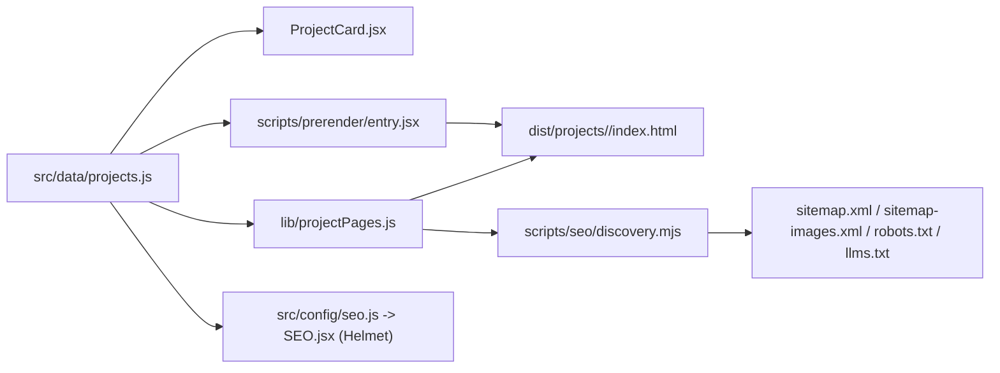
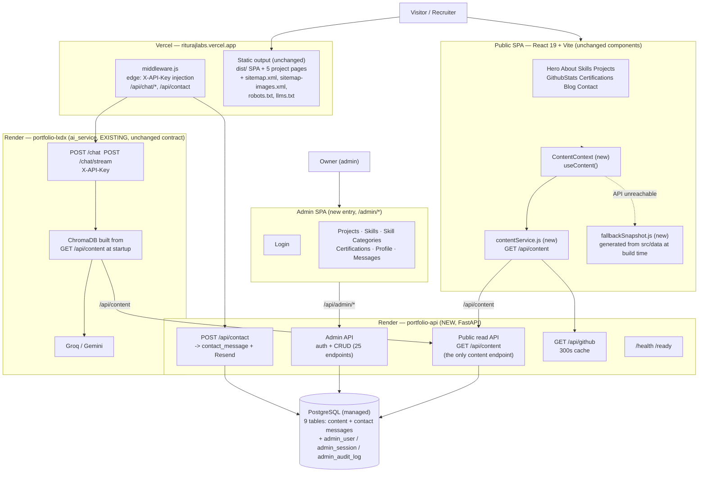
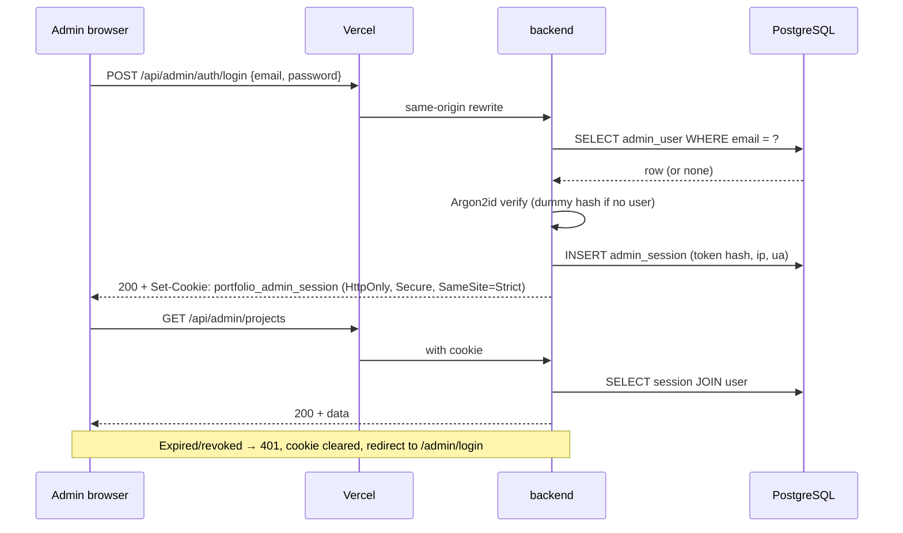

# System Architecture

**Document Status:** Active
**Document Type:** Technical Architecture
**Version:** 2.0 — rewritten from the verified codebase
**Last Verified Against Code:** commit `a6895e5` (`main`)

---

## Reading Convention

| Label | Meaning |
|---|---|
| **CURRENT** | Verified to exist in the code at the commit above. |
| **TARGET** | Does not exist yet. Contract for the next phase. |
| **MIGRATION** | How CURRENT becomes TARGET. |

Full analysis and evidence: `ANALYSIS.md`. Phased plan: `MIGRATION.md`.

---

# 1. Architecture Objective

Convert a **working** static portfolio into a **content-driven** portfolio while
preserving, byte-for-byte where possible:

* every public URL and its canonical
* every `<head>` tag, JSON-LD node and discovery file
* the visual design, animations and interactions
* the build pipeline and its validation guarantees
* the AI assistant, contact form and GitHub stats

**This is an upgrade to the data layer, not a rewrite of the application.**

---

# 2. Architecture Philosophy

1. **The public site stays static.** Content management does not require a
   server-rendered portfolio. The portfolio is a brochure; it should be served
   from a CDN.
2. **Build-time data fetching, not request-time fetching, for indexable pages.**
   Any URL that appears in `sitemap.xml` must exist as a real HTML file.
3. **One authoritative content store.** A second copy of portfolio content is a
   defect, not a cache.
4. **Additive services.** A new service is introduced without touching the
   working one until it is proven.
5. **Boring technology.** The stack is React + Vite + FastAPI + PostgreSQL +
   Vercel + Render. No new runtime, no new framework, no new language.
6. **Fail loud at build time, degrade gracefully at request time.** A build that
   silently produces fewer pages is a failed build.

---

# 3. CURRENT Architecture

Full Mermaid diagram in `ANALYSIS.md` §2. Summary:

```text
Vercel
├── dist/                         static output (1 SPA + 5 project pages + 4 discovery files)
├── admin.html                    separate admin SPA entry
├── middleware.js                 edge; injects X-API-Key for /api/chat/*
│                                 (contact/github are public — SECURITY.md §2.5)
└── vercel.json rewrites          /api/chat*, /health, /ready -> portfolio-lxdx.onrender.com
                                  /api/admin*, /api/contact, /api/github
                                                             -> portfolio-api-j7xc.onrender.com (TARGET)
                                  (no /api/content or /api/projects rewrite)

Browser
└── one route "/" + 7 in-page anchors
    ├── src/data/*.js             all content, hardcoded
    ├── src/lib/projectPages.js   single source of project SEO
    └── ChatAssistant             SSE, sessionStorage

npm run build (full pipeline: content → vite → isolation guard → prerender → pages → discovery)
1. node scripts/build-content.mjs           -> src/generated/content.js (fetch GET /api/content, fail-closed)
2. vite build                               -> dist/ SPA (+ admin entry)
3. node scripts/assert-admin-bundle.mjs     -> fails if admin code leaks into the public bundle
4. vite build --config vite.prerender...    -> .prerender/entry.mjs (SSR bundle)
5. node scripts/generate-project-pages.mjs  -> dist/projects/<slug>/index.html
6. node scripts/generate-seo-discovery.mjs   -> sitemap.xml, sitemap-images.xml, robots.txt, llms.txt

Render: portfolio-lxdx  (Python 3.11.9 / FastAPI / ai_service)
├── POST /chat, /chat/stream      X-API-Key required; Groq + Gemini
├── GET  /, /health, /ready       liveness + ChromaDB readiness
└── knowledge_base.json           hand-maintained -> ChromaDB (DRIFTED: 4 of 5 projects)
    (legacy /api/github + /api/contact routes remain in the code but are no
     longer reached — vercel.json routes those paths to portfolio-api, TARGET)
```

## 3.1 CURRENT Frontend Layers

| Layer | Location | Responsibility |
|---|---|---|
| Entry | `src/main.jsx` | `HelmetProvider` → `ThemeProvider` → `App` |
| Shell | `src/App.jsx` | `SEO`, `ScrollToTop`, `ScrollProgress`, `Navbar`, `Home`, `Footer`, lazy `ChatAssistant`, `SpeedInsights` |
| Page | `src/pages/Home.jsx` | Eager: Hero, About, Skills. Lazy: Projects, GithubStats, Certifications, Blog, Contact |
| Sections | `src/components/sections/` | One component per homepage section; each owns its CSS |
| Layout | `src/components/layout/` | Navbar, Footer, ThemeToggle |
| Common | `src/components/common/` | Button, SectionTitle, SocialLinks, ProjectCard, SEO, Loader, ScrollProgress, ScrollToTop, ChatAssistant |
| Pages (SSR) | `src/components/pages/ProjectPage.jsx` | Rendered once at build time by `renderToStaticMarkup` |
| Context | `src/context/` | `ThemeContext` only |
| Hooks | `src/hooks/` | `useTheme`, `useScrollSpy`, `useGithub` |
| Services | `src/services/` | `emailService` (fetch), `githubService` (fetch + fallback) |
| Lib | `src/lib/projectPages.js` | The single authority for project-page SEO |
| Data | `src/data/` | All hardcoded content |
| Styles | `src/styles/` | 17 hand-rolled CSS files + CSS custom properties |

## 3.2 CURRENT Data Flow



There is **one** content source and **two** consumers of it: the browser and the
build. That is the property the migration must keep — only the *first* edge
changes.

---

# 4. TARGET Architecture



## 4.1 What changed and what did not

**Phase 1.5 correction.** Phase 0 claimed the public frontend had a *zero* diff
and the build pipeline a *one-line* change. Both understate the work, and an
understated diff plan is how a migration overruns. The honest table:

| Layer | Change |
|---|---|
| Public components (JSX) | **1 file.** `About.jsx` moves 4 direct icon imports to the registry. Reason: `cards[].icon` is a React component and cannot be serialised, so it becomes `icon_key` (ADR-008). |
| Public components (props, markup, CSS) | **None.** Same JSX structure, same prop names, same class names. |
| `src/styles/*` | **None.** Zero diff. |
| Public routes | **None.** Still `/` + `/projects/<slug>/`. No router is introduced. |
| `src/data/skills.js` | Becomes a generated artifact; its 20 `icon:` component refs become `icon_key` strings. |
| `src/data/profile.js` | Two dead keys are **deleted**, not migrated: `seo` and `techStack` (neither has a consumer). |
| Build pipeline | **Not one line.** The prerender entry stops importing `src/data/*` and instead reads the fetched snapshot; `generate-project-pages.mjs` and `generate-seo-discovery.mjs` gain a fetch step and their dimension lookup becomes snapshot-derived. All existing validators, generators and error paths are retained. |
| Discovery files | **None.** Same generators, same validators, same output shape. |
| Chat contract | **None.** Same URLs, same shapes, same middleware semantics. |
| GitHub contract | **None.** Handler moves service; wire format identical. |
| Contact contract | **None.** Same schema, same status codes, same public auth model. Now also persists. |
| `src/data/*.js` | **Retained** as a committed generated fallback. Never hand-edited after Phase 7, never deleted. |
| **New** | `backend/`, `src/services/contentService.js`, `src/context/ContentContext.jsx`, `src/data/fallbackSnapshot.js`, `src/components/icons.js` (registry), `src/admin/**`, 2 columns on `project`. |

---

# 5. Architecture Decision Records

### ADR-001 — The public portfolio remains a static site

**Decision.** No SSR framework. The existing build-time prerender stays.

**Rationale.** `scripts/generate-project-pages.mjs` already emits fully
server-rendered HTML with correct `<head>` metadata, JSON-LD, preload hints and
measured image dimensions — and validates them. Next.js/Remix/Nuxt would replace
a working, tested pipeline with a rewrite, change the bundle shape, and risk the
canonical URLs.

**Consequences.** Content changes require a rebuild. That is acceptable for a
portfolio edited a few times a month, and it is what keeps the site on a CDN.

---

### ADR-002 — A new `backend/` service; `ai_service` is not extended

**Decision.** Create `backend/` as a standalone FastAPI service for content. Keep
`ai_service` as a separate FastAPI service for chat/RAG only.

**Rationale (evidence-based).**

* `ai_service` gates readiness on ChromaDB ingestion (`core/startup.py`,
  `/ready` → 503). Portfolio content must not be unavailable while a vector
  index builds.
* `ai_service` already demonstrates the exact stack a content backend needs:
  FastAPI + Pydantic `extra="forbid"` + slowapi + Resend + GitHub proxy + a
  5-minute in-process TTL cache + `/health` + `/ready` + `Procfile` +
  `runtime.txt`. Reusing it is *less* new code than diverging from it.
* One language across both Python services; one deployment platform (Render);
  one set of operational patterns.
* Two independently deployable services is still simple. It is not a
  microservice split — it is a split along the availability boundary that
  already exists in production.

**Consequences.** Two Python services to maintain. Justified: they have
different availability requirements and different data lifetimes (AI needs a
vector index; content does not).

---

### ADR-003 — Content is read once per build; the browser fetches one aggregated payload

**Decision.** Build time: one `GET /api/content`. Runtime: one `GET /api/content`
per page load, cached with an `ETag`.

**Rationale.** Today the SPA makes 2 API calls (`/api/github`, and chat on
demand). Content is a single homepage. Aggregating into one request means: one
round trip, one cache entry, one `ETag`, and trivially correct consistency
between sections (skills and projects can never disagree).

**Consequences.** A future multi-page site would need per-page endpoints. Design
`GET /api/content` to be splittable (`?include=projects,skills`) without breaking
v1.

---

### ADR-004 — Prerendering keeps generating files; only its data source changes

**Decision.** `scripts/prerender/entry.jsx` resolves projects from a build-time
snapshot that is fetched from `GET /api/content`. All existing
`src/lib/projectPages.js` logic, all generators and all ~20 build-time
assertions stay.

**Rationale.** The build already validates the project content schema. Replacing
prerendering with request-time rendering would delete five indexable URLs and
four discovery files. Changing the *source* of the data preserves every
guarantee.

**Hard rule.** `src/lib/projectPages.js` may only have its data import changed.
Every exported function and every comment stays. This is the single most
important constraint in the migration — it is what makes Phase 7 revertible
with one `git checkout`.

---

### ADR-005 — Build-time failure is loud; runtime failure is graceful

**Decision.**

| Situation | Behaviour |
|---|---|
| `GET /api/content` unreachable at build | **Build fails** with a clear message |
| API returns zero projects at build | **Build fails** |
| `image_width`/`image_height` mismatch the real WebP header | **Build fails** (existing check, now sourced from the DB) |
| API unreachable in `npm run dev` | Render the committed fallback snapshot, log one warning |
| API unreachable against the deployed static site | Irrelevant — the site is already static |
| One content endpoint 500s at runtime | Render that section's fallback; the page still renders |

**Rationale.** A build that quietly emits 3 project pages instead of 5 is worse
than a failed build: it silently deletes indexed URLs. A *user-facing* page that
fails because the content API had a bad minute is also unacceptable. Both
behaviours are required and they are not in conflict.

---

### ADR-006 — The AI knowledge base is derived, not authored

**Decision.** `ai_service` builds its ChromaDB index from `GET /api/content`.
`knowledge_base.json` is retired once parity is proven.

**Rationale (evidence).** `knowledge_base.json` has 4 projects;
`src/data/projects.js` has 5. The assistant cannot answer questions about
`Zerodha Clone`. `scripts/seo/discovery.mjs:626-659` already exists as a drift
guard for `llms.txt` — the AI knowledge base needs the same treatment.

**Fallback.** `KNOWLEDGE_SOURCE=file` keeps the committed snapshot working, so
this is revertible by one env var and one redeploy.

---

### ADR-007 — Image dimensions become data; the build still verifies them

**Decision.** `project.image_width` / `image_height` are DB columns. The
generator keeps cross-checking them against the real WebP container header and
still fails the build on a mismatch. The image path contract
(`/images/projects/<slug>.webp`) is unchanged.

**Rationale.** `src/lib/projectPages.js:105-111` is a hardcoded slug→size map
that throws for an unknown slug, and `generate-project-pages.mjs:212` requires
`project.image === /images/projects/<slug>.webp`. A project created through a
CMS without updating the JS map **breaks the production build**. Moving the
dimensions to the database removes the manual step; keeping the verification
keeps the guarantee.

**Non-goal (narrowed 2026-10-14).** No image *library*: only a project cover
image can be uploaded, via `POST /api/admin/uploads`, and the build still
verifies every project image's dimensions. The resume, profile image, favicons,
manifest and OG image remain committed files. See ADR-012's update and
`PRODUCT_REQUIREMENTS.md` §5.

---

### ADR-008 — Icons stay in code; only an icon key is stored

**Decision.** `skills.js` stores React icon *components*. The database stores a
string `icon_key`, and the frontend maps it to a component through a fixed
registry.

**Rationale.** Icons are code, not data. Storing `"FaReact"` and failing loudly
on an unknown key is safe. Storing a component reference is impossible in JSON.
A fixed registry means an admin typo produces a visible error, not a broken
site.

**Phase 1.5 correction — the registry does not exist yet.** ADR-008 was written
as though the mechanism were already in place. It is not. Verified today:

* `src/data/skills.js:25-110` stores `icon: FaReact` — real component references.
* `src/components/sections/About.jsx:3-8` imports `FaGraduationCap`, `FaCode`,
  `FaBrain`, `FaRocket` directly.
* `ls src/components/icons/` → **no such directory.**
* `grep -rn "icon_key" src/` → **zero matches.** The string appears nowhere.

So Phase 5 creates `src/components/icons.js` — a flat `iconKey → component` map
covering the 4 About icons, 4 category icons and 16 skill icons — and rewires
those two files to read through it. It is one new file plus import swaps, and it
is the **only** public-component change in the migration (§4.1).

**Registry contract.** The map is exhaustive and closed: an `icon_key` absent
from it renders a visible `?` placeholder **and logs an error**, and a unit test
fails if any `icon_key` in the API payload is missing from the registry. An
admin picking an unknown key must not produce a silently blank badge.

---

### ADR-009 — Admin auth is user-based and separate from the AI shared secret

**Decision.** `admin_user` + `admin_session` + `admin_audit_log` tables, Argon2id,
and an `HttpOnly; Secure; SameSite=Strict` cookie. The existing `X-API-Key` /
`BACKEND_API_KEY` mechanism keeps protecting `/api/chat/*` — it is no longer
sent to `/api/contact`, which the backend never verified (`SECURITY.md` §2.5) —
and is **not** reused for admin operations.

**Rationale.** `BACKEND_API_KEY` is one shared secret applied to every visitor's
request. It authenticates a *route*, not a *user*: there is no identity, no
revocation and no audit trail. Public read endpoints need no auth at all.

**Consequences.** Two auth mechanisms coexist. They are separated by route, so
confusion is bounded; and the admin cookie is `SameSite=Strict`, so it is never
sent to the chat proxy.

---

### ADR-010 — The admin dashboard is a separate Vite entry, routed by `react-router-dom`

**Decision.** A second HTML entry (`/admin`) with its own React root and bundle,
served by a `vercel.json` rewrite, using **`react-router-dom` scoped to that
entry**. The public entry keeps zero routing dependencies.

**Rationale.** The public bundle must not grow by the size of an admin app. A
separate entry guarantees this structurally rather than by discipline. It also
means an admin bug cannot affect the public site, and the public SPA keeps its
zero-router shape.

**Sub-decision now closed: `react-router-dom`.** Phase 1.5 was required to
settle this rather than leave it open. Reasoning:

| Option | Verdict |
|---|---|
| **`react-router-dom` in the admin entry** | **Chosen.** Nested routes, 404s, link interception and history handling are the majority of an admin SPA's routing code. It is already in the dependency tree, so the admin entry shares one copy. Cost is irrelevant because the admin bundle is never loaded by a visitor. |
| Hand-rolled routing | Rejected. The admin UI needs list → edit → back flows plus a 404. That is precisely where hand-rolled routing accumulates bugs, and the saving is zero on a bundle only admins load. |
| `react-router-dom` in the public entry | Rejected. Would add a router to every visitor's bundle to serve no public route. |

**Consequences**

* `react-router-dom` is **not** imported by any file reachable from
  `src/main.jsx`. A bundle-size assertion in `TESTING.md` fails if it is.
* Admin routes are server-rendered by no one; every `/admin/*` URL is rewritten to
  `/admin/index.html` so a deep link survives a refresh.
* The admin bundle is split from the public one by `build.rollupOptions.input`,
  which also means **Phase 5 must modify `vite.config.js`.** Phase 0's claim
  otherwise was wrong. `index.html` and `vercel.json` change too.

---

### ADR-011 — PostgreSQL, not MongoDB

**Decision.** PostgreSQL via a managed provider, SQLAlchemy 2.x + Alembic.

**Rationale.** The content model is relational and the access patterns are
analytical:

* `display_order` + `is_visible` filtered listings — natural composite indexes.
* `UNIQUE (slug)` on `project` — a hard constraint, not application logic.
* `skill` → `skill_category` foreign key — prevents orphan skills in SQL; a
  MongoDB validator would still be application-enforced and racy.
* Admin tables need filtered, sorted, paginated queries — trivial in SQL.
* `text[]` for `project.tech_stack` — a native array type, no embedded documents.
* One free managed instance; no driver choice to get wrong.

MongoDB would also be defensible (MERN familiarity). The deciding factor is the
requirement for integrity constraints across the project/skill/category graph,
not familiarity.

**Status:** decision is provisional until Phase 2 begins; Phase 1 must not
hard-code an ORM choice that forecloses it.

---

### ADR-012 — Static assets stay in `public/`

**Decision.** No object storage, no CDN bucket, no upload endpoint in this
migration.

**Rationale.** There are 5 project images, 1 profile image, 1 resume PDF, 9
favicon/manifest files and 1 OG image — all committed, all immutable, all served
with 1-year immutable cache headers. An upload pipeline would break the
`image === /images/projects/<slug>.webp` build contract and add a security
surface (file type, size, path traversal, malware) for zero current benefit.

**Trigger to revisit** — an explicit requirement to upload images from the
admin UI. Documented in `MIGRATION.md` §3.

**Update (2026-10-14) — trigger fired; partially superseded.** The owner asked
for image upload from the admin UI, so `POST /api/admin/uploads` now stores a
project cover image in S3-compatible object storage (Neon Object Storage) and
returns its public URL. Scope is deliberately narrow:

* Only **project cover images** are uploadable. The resume, profile image,
  favicons, manifest and OG image stay committed in `public/`; ADR-012 still
  governs them.
* The `image === /images/projects/<slug>.webp` build contract is **extended, not
  replaced**: `project.image` accepts that path *or* an absolute `http(s)` URL,
  enforced by the same `image_path` CHECK (`0003_project_image_url`). Existing
  rows and the committed-image workflow are unchanged.
* The upload route keeps the guarantees ADR-012 was protecting: type and size are
  gated (`WebP/PNG/JPEG/GIF`, `S3_IMAGE_MAX_BYTES`), the server measures the
  dimensions itself, the object key is server-generated (no caller path), and the
  bucket is `public_read` because the URL is baked into the static build.
* Every upload writes one `admin_audit_log` row (`entity='upload'`).

The added surface is therefore one authenticated, CSRF-protected, size- and
type-checked endpoint and one S3 client, traded for removing the "commit a file
and hand-edit a path" step from the owner's workflow.

---

### ADR-013 — REST over GraphQL

**Decision.** REST.

**Rationale.** One consumer, one payload shape, ~20 endpoints. GraphQL adds a
schema, a server, a client library and an introspection surface for no benefit
here. `GET /api/content` already solves the single query the app actually makes.

---

### ADR-014 — In-process caching; no Redis

**Decision.** Per-process TTL caches, as already used for GitHub data.

**Rationale.** The patterns that benefit — GitHub proxy (300 s), LLM responses
(120 s) — are low-QPS and single-instance. HTTP caching (`ETag`, `Cache-Control`)
covers the content API at the CDN edge, which is the layer that matters. Redis
would be infrastructure with no measured problem to solve.

---

### ADR-015 — Admin routes are never protected by frontend logic alone

**Decision.** Every `/api/admin/*` route requires a valid server-side session.
There is no client-only guard, and no "hidden" UI is treated as protection.

**Rationale.** Standard, and stated because client-side route protection is the
most common way admin APIs end up unprotected.

---

### ADR-016 — v1 has no draft/publish workflow; two independent visibility flags

**Decision.** `project.status ∈ ('published', 'hidden')` — two values, not three.
Separately, `project.indexable ∈ (true, false)`. There is **no** `draft`, **no**
`archived`, and **no** multi-step publish flow. Full derivation: `DATABASE.md`
§8.

| Concern | Flag |
|---|---|
| Should a visitor see this project? | `status` |
| Should it get a page, a sitemap entry and JSON-LD? | `indexable` |

**Rationale.** Phase 0 proposed `draft | published | archived`. That is a CMS
convention imported by analogy, and no driver for it exists here: there is one
author, no scheduled publishing, no approval workflow and no editorial review.
`admin_audit_log` already covers "what changed, when".

The one plausible driver — hiding half-written content — is **already satisfied**
by `indexable`, which today already decides whether a project gets a page, a
sitemap entry and a sitemap-image entry (`src/lib/projectPages.js:140-160`).
Adding a third status would add a branch to every read query for no new
capability.

**Consequences.**

* Both flags are required. `indexable=false` alone leaves the project on the
  homepage; `status='hidden'` alone removes its page but leaves it in the sitemap.
* `archived` is expressed as `status='hidden'` + `indexable=false`.
* Soft delete is a status change, not a `DELETE` row.
* If a second editor is ever added, this ADR is superseded — not edited in place.

---

### ADR-017 — Content changes are published by an explicit build, not a request

**Decision.** Editing in the admin dashboard writes to PostgreSQL immediately.
It does **not** publish. Publication requires an explicit `npm run build` and
deploy, triggered by the admin's **"Rebuild site"** button, which calls a Vercel
deploy hook. Automatic rebuild-on-write is rejected.

**Rationale.** The public site stays static and prerendered (ADR-001, ADR-004).
That buys CDN delivery, stable URLs, working SEO and failure isolation — none of
which survive a switch to request-time database rendering.

The trigger is explicit rather than automatic because an automatic build that
fails leaves the deployed site serving content that no longer matches the
database. A manual deploy means the owner sees a failed build before anything
diverges. The button is a convenience, not an automation.

**Consequences.**

* An admin save is authoritative in the database **immediately**; the public site
  catches up at the next build. These are different things and must not be
  confused.
* `backend/` readiness is a **prerequisite** of the build, so the build must run
  against a reachable, migrated, seeded API (the bootstrap order in
  `MIGRATION.md` §4).
* A failed build is loud (ADR-005) and leaves the previous deployment serving —
  which is the correct outcome, not a bug.
* After a build, `ai_service` reindexes from the API (Phase 9) so chat answers
  match the newly published site.

---

# 6. Frontend Data Flow — CURRENT vs TARGET

## 6.1 CURRENT

```text
Hardcoded JS  →  Components
src/data/projects.js ──► ProjectCard.jsx ──► DOM
src/data/profile.js  ──► Hero / Navbar / Footer
src/data/skills.js   ──► Skills.jsx
```

## 6.2 TARGET

```text
Backend API  →  contentService  →  ContentContext  →  Existing components
GET /api/content          fetch + ETag      useContent()          unchanged JSX
       │
       └──► failure ──► fallbackSnapshot.js (committed, generated at build)
```

**Component-level impact is one hook call.** For example, `Projects.jsx`
becomes:

```jsx
// CURRENT
import { indexableProjects } from "../../lib/projectPages";
{indexableProjects().map((project, index) => ( ... <ProjectCard project={project} /> ... ))}

// TARGET
import { useContent } from "../../context/ContentContext";
const { projects, status } = useContent();
{projects.map((project, index) => ( ... <ProjectCard project={project} /> ... ))}
```

`ProjectCard`'s `propTypes` shape is unchanged, so its behaviour, modal,
accessibility and animations are untouched. **That is the whole point of the
design: the data source moves, the UI does not.**

## 6.3 Loading and error UX

| `status` | Public behaviour |
|---|---|
| `loading` | The existing `Loader` skeleton inside the existing `Suspense` boundary — no new UI |
| `ready` | Normal render |
| `error` | Fallback snapshot renders. Sections that have a fallback show it. No error banner, no layout shift |

**Rationale.** A portfolio that shows a red error banner when a content API has
a slow minute looks broken to a recruiter. Falling back silently is correct here.
The failure is still observable — one `console.warn` and the backend's own
monitoring.

---

# 7. Admin Architecture (TARGET)

```text
                     /admin/login
                           │
                    POST /api/admin/auth/login
                           │
                  admin_user + admin_session
                           │
             ┌─────────────┴─────────────┐
             ▼                           ▼
   Portfolio admin                Owner only
   ├─ Projects      CRUD          ├─ Messages   read-only
   ├─ Skills        CRUD          └─ Deploy     documented runbook link
   ├─ Certifications CRUD
   ├─ Education     CRUD
   ├─ Profile       edit
   ├─ Social links  CRUD
   └─ Blog          CRUD
             │
             ▼
      POST /api/admin/auth/logout  →  session revoked, cookie cleared
```

**Roles.** v1 has exactly one role: `ADMIN`. There is no role-management UI
because there is no second user. Adding roles is deferred
(`MIGRATION.md` §3).

**Session.** 12 h idle / 7 days absolute. Every admin mutation writes an audit
row (`actor_user_id`, `action`, `entity`, `entity_id`, `at`). Audit rows are
never deleted.

**The admin UI is visually and structurally separate from the public design
system.** `DESIGN_SYSTEM.md` §4 states the boundary explicitly. No admin stylesheet
may be imported by a public component, and no public stylesheet may be modified
for admin purposes.

---

# 8. Authentication Flow (TARGET)



**Public read endpoints require no authentication.** They carry no secrets and
are cacheable.

**`X-API-Key` remains in place for `/api/chat/*`** — unchanged, so the AI
assistant is unaffected by any of this. Contact stays public and rate-limited,
matching today's behaviour; see `SECURITY.md` §2.5.

---

# 9. Rendering Strategy (TARGET)

| Content type | Rendering | Rationale |
|---|---|---|
| Homepage `/` | Static SPA + build-time content snapshot | One route, no SEO pressure beyond the baseline in `index.html` |
| Project pages `/projects/<slug>/` | **Prerendered static HTML at build time** | Indexed, canonical, JSON-LD, in the sitemap |
| Discovery files | Generated at build time | Must match the emitted files exactly |
| Admin | Client-rendered SPA | Never indexed; `robots.txt` blocks `/api/`, admin is behind auth |
| Chat | Runtime API | Never indexed |

**The build remains the SEO contract.** A content change becomes public only
after an explicit build and deploy (ADR-017), which is correct: a portfolio page
should be a stable, immutable document at a stable URL.

## 9.1 The end-to-end content flow — one screen

```text
  Admin dashboard
        │  PUT /api/admin/projects/{id}        (or projects, skills, certifications, profile)
        ▼
  PostgreSQL  ◀── AUTHORITATIVE from this instant. The save has happened.
        │
        │  ── no request-time DB rendering of the public site ──
        ▼
  "Rebuild site" button ──▶ Vercel deploy hook ──▶ npm run build
        │
        │  fetch GET /api/content  ──fail──▶ BUILD FAILS, previous deploy keeps serving
        │
        ├─ validate: schema, slugs, image dims vs real WebP headers,
        │            SEO fields, sitemap sanity, ≥1 indexable project
        ├─ prerender 5 project pages
        ├─ emit sitemap.xml · sitemap-images.xml · robots.txt · llms.txt
        └─ write src/data/fallbackSnapshot.js  (generated, never hand-edited)
        ▼
  Vercel atomic deployment ──▶ public content updated
        │
        ▼
  ai_service reindexes from GET /api/content  (Phase 9)
```

**The one-sentence answer to "is the site dynamic?":** content is managed
dynamically and served statically. The admin UI is dynamic; the public portfolio
is prerendered at build time and served from a CDN.

**Content freshness on the homepage.** After a rebuild, Vercel's CDN serves the
new build from the atomic deployment. No `Cache-Control` change is needed for
HTML because Vercel handles deployment-scoped caching for it; the `max-age=3600`
headers in `vercel.json` apply only to the discovery files, which are appropriate.

---

# 10. Failure Isolation (TARGET)

| Failure | Blast radius | Mitigation |
|---|---|---|
| `backend/` down | Homepage content reverts to the fallback snapshot; build fails | ADR-005 |
| PostgreSQL down | Same | CDN-served static output keeps working |
| `ai_service` down | Chat widget shows its existing error message; **the rest of the site is unaffected** | Separate service (ADR-002) |
| ChromaDB ingestion slow | `/ready` 503; chat degraded | Already implemented |
| GitHub upstream down | `GithubStats` shows the existing fallback | Already implemented (`githubService.js:19-26`) |
| Resend down | Contact message stored, delivery marked failed, user sees a retry message | `messages.py` |
| Bad admin input | Field-level validation errors, nothing persisted | Pydantic `extra="forbid"` |

**Principle:** a dependency's failure may degrade its own feature and nothing
else. Today, an `ai_service` outage already cannot take the portfolio down —
because the portfolio is static. The migration must not undo that.

---

# 11. Caching Strategy (TARGET)

| Layer | Target | TTL |
|---|---|---|
| Browser | `GET /api/content` with `ETag` | `max-age=300, stale-while-revalidate=600` |
| Vercel edge | **N/A** — `/api/content` is never a Vercel path; the build and `ai_service` fetch it server-to-server from `portfolio-api` | — |
| `backend/` | No server-side cache needed for content — the DB read is sub-millisecond at this size | — |
| GitHub proxy | In-process TTL (existing) | 300 s |
| LLM responses | In-process TTL (existing) | 120 s |
| Static assets | `immutable, max-age=31536000` (existing) | 1 year |

**No Redis, no CDN cache purging, no cache-invalidation endpoint.** Content
changes require a rebuild, so the API's data is already immutable between
builds. `ETag` handles the multi-tab case.

---

# 12. Observability (TARGET)

| Signal | Where | Notes |
|---|---|---|
| Frontend errors | Vercel Speed Insights (existing) | No change |
| Build failures | Vercel build logs | The build is the primary content-integrity signal |
| `/api/content` latency + 5xx | Render logs + platform metrics | Alert on 5xx rate > 1% over 15 min |
| `/health`, `/ready` | Render health check | `/ready` must gate traffic on `backend/` |
| Admin audit log | `admin_audit_log` table | Who changed what, when |
| Contact delivery status | `contact_message.delivery_status` | Distinguishes stored from delivered |
| AI readiness | `/ready` on `ai_service` (existing) | ChromaDB ingestion state |

**Deliberately absent:** no error-tracking SaaS, no APM, no custom metrics
pipeline, no log aggregation service. Render/Vercel logs plus the audit table
are sufficient for a single-developer portfolio.

---

# 13. Security Boundaries (TARGET)

```text
INTERNET
   │
   ├── Vercel edge ── headers (nosniff, frame-options, HSTS, referrer, COOP, CORP, permissions)
   │      │
   │      ├── static assets  (immutable cache, no secrets)
   │      │
   │      ├── middleware.js  X-API-Key injection
   │      │      └── /api/chat/*   (contact/github are public)
   │      │
   │      └── explicit rewrites (destination per path; no `/api/*` wildcard)
   │             ├── /api/chat/*     -> portfolio-lxdx; X-API-Key REQUIRED
   │             ├── /api/admin/*    -> portfolio-api; session cookie REQUIRED
   │             ├── /api/contact    -> portfolio-api; rate limited; X-API-Key NOT verified
   │             └── /api/github     -> portfolio-api; public, cached
   │
   ├── portfolio-lxdx (ai_service) ── X-API-Key, signed client-IP, rate limits
   │
   └── portfolio-api (backend/) ── CORS allow-list, rate limits, Pydantic validation,
                       Argon2id, server-side sessions, parameterised SQL

GET /api/content is NOT a Vercel rewrite: the build and `ai_service` fetch it
server-to-server from `portfolio-api`.
```

Full rules: `SECURITY.md`.

---

# 14. Migration Strategy (summary)

Full plan: `MIGRATION.md`.

```text
Phase 0   Analysis + documentation      DONE
Phase 1   backend/ foundation           no public traffic
Phase 2   Database + migrations         no public traffic
Phase 3   Public read API               no public traffic
Phase 4   Admin authentication          no public traffic
Phase 5   Admin dashboard               /admin only
Phase 6   Content migration             JS files still live, site unchanged
Phase 7   Frontend read path            HIGHEST RISK — build fails loudly on API problems
Phase 8   contact + GitHub re-point     one-line vercel.json rewrite
Phase 9   AI knowledge base from API    env-var revertible
Phase 10  Testing + CI                  additive
Phase 11  Deployment, ordered, verified every step
Phase 12  Production verification       evidence, not assertion
```

**Invariant across every phase: the live portfolio keeps working.** Each phase is
independently revertible; Phase 7 reverts with a single `git checkout`.

---

# 15. Explicit Non-Goals

| Not doing | Why |
|---|---|
| Redesigning the public UI | No requirement asks for it. `PRODUCT_REQUIREMENTS.md` §5. |
| Adding a router to the public SPA | One route. ADR-010 scopes `react-router-dom` to the admin entry only. |
| SSR framework | ADR-001. |
| Request-time database rendering of the public site | ADR-001, ADR-017. |
| Deleting `src/data/*.js` | It is the build fallback. Removal is a separate approved cleanup after Phase 12. |
| Blog reading route, `blog_post` table, blog admin UI | No post exists. `DATABASE.md` §9. All three arrive together, or none. |
| Draft / archived states | ADR-016. `status` + `indexable` cover it. |
| Automated rebuild on content write | ADR-017. |
| Contact retry queue or admin resend button | `API.md` §5.2. The message is already stored and visible in the inbox. |
| Education entity and admin UI | There is no education section on the site. `DATABASE.md` §1.3. |
| `social_link` entity and admin UI | Order, labels and icons are code in `socials.js`. `DATABASE.md` §5.1.2. |
| Project reorder endpoint | 5–20 rows; ordinary `PUT`s suffice. `API.md` §4.1. |
| Experience / achievements sections | Not on the site. |
| Image upload / object storage | ADR-012. |
| Analytics pipeline | Only Speed Insights today. |
| Multiple admin roles | Single user. |
| Redis, queues, events, Kubernetes, GraphQL, microservices | No workload needs them. |

---

# 17. Final Decision Register

**Authoritative and closed. No item is TBD.** If an implementation contradicts
this register, the implementation is wrong — this register, not code, is the
tie-breaker.

## 17.0 FINAL ARCHITECTURE DECISIONS

```text
Frontend:
React + Vite

Backend:
FastAPI

Database:
PostgreSQL

ORM:
SQLAlchemy 2.x

Migration:
Alembic

Public API:
GET /api/content

Admin:
Separate admin application

Admin Routing:
react-router-dom only inside admin bundle

Authentication:
Argon2id + server sessions

Images:
Committed static assets in v1

SEO:
Existing prerender pipeline preserved

AI:
Separate ai_service consuming content API

Publishing:
Admin save → database → explicit rebuild → deployment

Blog:
Deferred

Deployment:
Vercel + backend hosting + managed PostgreSQL
```

## 17.0.1 Terminology lock

These are the only terms this documentation uses. Alternate phrasings are drift.

| Component | Term | Never described as |
|---|---|---|
| Frontend | **React + Vite portfolio, deployed on Vercel** | Next.js, Remix, Nuxt, an SSR framework, a CMS |
| Backend | **FastAPI content API, deployed separately** | an enterprise CMS, a microservices cluster, a BaaS |
| AI service | **existing `ai_service/`, separate deployment** | part of the backend, a vector database service |
| Database | **managed PostgreSQL** | MongoDB, Firebase, a document store |
| Data access | **SQLAlchemy 2.x + Alembic** | Prisma, TypeORM, a hand-rolled query layer |

**Why this matters.** Before Phase 0, all eight documents in `docs/` described a
*different product*: a "Personal Developer Platform" on Next.js + Prisma +
PostgreSQL with blog revisions, scheduled publishing, autosave, analytics, a media
library, custom pages, navigation management and site search
(`ANALYSIS.md` finding F1). None of that ever existed here. The five terms above
are the guard against it creeping back in.

## 17.0.2 Source-of-truth lock

Stated identically in `DATABASE.md` §6, `API.md` §5.1 and `MIGRATION.md` Phase 6–7.

```text
  DURING MIGRATION (Phase 0 – 6)
  ─────────────────────────────
  src/data/*.js
        │
        ├──► seed source      (one-time import into the database)
        └──► rollback snapshot (git is the history of every content change)

  AFTER MIGRATION (Phase 7+)
  ─────────────────────────
  PostgreSQL
        │
        └──► the ONE editable source of portfolio content
              (changed only through the admin UI, never in a file)
```

**Three rules that make this hold.**

1. **The regimes never overlap.** `src/data/*.js` is the only editable source
   before Phase 7 and stops being editable at Phase 7. There is no window in
   which both are editable.
2. **After Phase 7 it is a generated artifact.** `src/data/fallbackSnapshot.js`
   is written by the build from the API and is committed only as a fallback. It is
   never hand-edited — a manual edit fails `seed:verify`, which is what makes the
   rule enforceable rather than aspirational.
3. **A developer is never instructed to edit both.** The admin dashboard is the
   single place content changes.

**Deliberately static, and therefore not in conflict with this rule:** the navbar
and footer link arrays (layout, not content), `seo.url` and `seo.verification`
(properties of the domain, not the person — `DATABASE.md` §5.1.3), the four blog
placeholder strings (`DATABASE.md` §9), and everything in `public/` (binary assets).

## 17.0.3 AI content-source lock

The three-state lifecycle. `ai_service` never becomes a content authority.

```text
  CURRENT
  ───────
  knowledge_base.json ──► AI source
       (manually maintained, 4 of 5 projects — Zerodha Clone is missing)

  MIGRATION (Phase 9)
  ──────────────────
  knowledge_base.json ──► parity fallback ONLY, retained until proven equal
  GET /api/content    ──► AI ingestion source

  FINAL
  ─────
  GET /api/content
        │
        └──► ai_service ──► RAG index (ChromaDB)
```

`knowledge_base.json` is a **temporary migration artifact**, a **parity
fallback**, and eventually a **generated snapshot**. It is never a permanent
source, and it is never edited by hand after Phase 9. Reverting this transition is
one environment variable (`KNOWLEDGE_SOURCE=file`) plus a restart — see
`MIGRATION.md` §4.6.

## 17.1 Decision audit trail

The register above is the answer. This table records how each item got there, so
the change from Phase 0 is auditable rather than invisible.

| # | Question | **FINAL DECISION** | Superseded | Detail |
|---|---|---|---|---|
| 1 | Frontend framework | **React 19 + Vite 8, static prerendered SPA.** No SSR framework, no public router. | — | ADR-001, §9 |
| 2 | Backend service | **New standalone FastAPI `backend/`.** `ai_service` is not extended and does not own content. | — | ADR-002 |
| 3 | Database | **PostgreSQL 16, managed.** Exactly **9 tables** (`DATABASE.md` §0). | "14 tables"; 16 enumerated | ADR-011, `DATABASE.md` §1 |
| 4 | ORM / migrations | **SQLAlchemy 2.x async + Alembic.** Not Prisma — one ORM across both Python services. | Prisma (considered) | `DATABASE.md` §3 |
| 5 | Public content API | **One endpoint: `GET /api/content`.** Build, browser and AI all use it. | Also `GET /api/projects`, `GET /api/projects/{slug}` | `API.md` §4.1, §5.1 |
| 6 | Admin API | **25 endpoints.** One project-image upload (`ADR-012` update); still no reorder, no image-meta, no blog, no education, no social-links. | ~25 | `API.md` §6 |
| 7 | Admin routing | **`react-router-dom`, scoped to a separate `/admin` Vite entry.** Never in the public bundle. | "open sub-decision" | ADR-010 |
| 8 | Admin authentication | **Argon2id + opaque server-side sessions.** `ADMIN_TOKEN` prohibited. `X-API-Key` never used for admin. | — | ADR-009, `API.md` §6.1 |
| 9 | Session cookie | **`HttpOnly; Secure; SameSite=Strict; Path=/`.** 12 h idle / 7 d absolute. Logout revokes immediately. No token in `localStorage`. | — | `API.md` §6.1 |
| 10 | Static assets | **Committed to `public/`**, plus one narrow exception: a project cover image may be uploaded to a `public_read` object-storage bucket (`POST /api/admin/uploads`, ADR-012 update). No media table. | — | ADR-012, `DATABASE.md` §10 |
| 11 | Page generation | **`generate-project-pages.mjs` and `generate-seo-discovery.mjs` retained, unmodified in behaviour.** Only their data source changes. | — | ADR-004 |
| 12 | Build data source | **Build-time `GET /api/content`, with committed `fallbackSnapshot.js` as a last-resort dev fallback.** Never hand-edited after Phase 7. | — | ADR-003, §17.0.2 |
| 13 | AI knowledge base | **`ai_service` ingests from `GET /api/content`.** `knowledge_base.json` is a parity fallback, deleted only after verification. | Manual `knowledge_base.json` as source | ADR-006, §17.0.3 |
| 14 | Blog | **Static placeholders only.** No table, no route, no admin UI, no sitemap entries. | `blog_post` table + CRUD + `/blog/:slug` | `DATABASE.md` §9 |
| 15 | Source of truth | **PostgreSQL after cutover.** `src/data/*.js` becomes a generated fallback; a developer never edits both. | Two editable sources | §17.0.2 |
| 16 | Deployment | **Vercel (frontend) · backend hosting (`backend/`) · Render (`ai_service/`) · managed PostgreSQL.** 13 steps, `DEPLOYMENT.md` §6. | — | `DEPLOYMENT.md` |
| 17 | Publishing | **No draft/publish workflow.** `status ∈ (published, hidden)` + independent `indexable`. An admin save goes to the database immediately; it goes live only after an explicit rebuild triggered by the admin's "Rebuild site" button. | `draft \| published \| archived`; "content changes trigger a rebuild" (unowned) | ADR-016, ADR-017 |
| 18 | Rollback | **One model — Risk → Detection → Rollback action → Recovery verification**, 7 named risks. `MIGRATION.md` §4 is authoritative; no other document restates it. | "revert if something breaks"; rollback duplicated across 4 files | `MIGRATION.md` §4 |

## 17.2 Architectural invariants

These hold at **every** phase and are the acceptance criteria for Phase 12:

1. No public URL is removed, renamed or added. `/` + exactly 5 project pages.
2. `sitemap.xml`, `sitemap-images.xml`, `robots.txt`, `llms.txt` keep their
   exact shapes and their 5 + 5 + 7 URL counts.
3. `/api/chat`, `/api/chat/stream`, `/api/github`, `/api/contact` keep their
   paths, request schemas, response shapes and status codes.
4. The public bundle contains no secret and, from Phase 5, no
   `react-router-dom`.
5. The build fails loudly on bad content; a deployed static site survives any
   runtime dependency outage.
6. No HTML in `dist/` changes except by intentional content edit.
7. `src/styles/*` is byte-identical.

## 17.3 What Phase 1.5 changed, in total

| Area | Before review | After review |
|---|---|---|
| Table count | "14", while listing 16 | **9**, with 7 removals justified |
| Public content endpoints | 3 (`content`, `projects`, `projects/{slug}`) | **1** (`content`) |
| Admin endpoints | ~25 | **24**, with 7 endpoint groups removed |
| Blog | table + CRUD + route planned | static, deferred |
| `profile.seo`, `profile.techStack` | implicitly migrated | **dead code, deleted** |
| `site_profile` columns | ~19 | **16**, each with a verified consumer |
| Icon registry | assumed to exist | **new file, new work, bounded** |
| Public component diff | claimed "none" | **1 file** (`About.jsx`) |
| Build pipeline diff | claimed "one line" | fetch step + snapshot-derived dimensions |
| Admin routing | open sub-decision | **closed**: `react-router-dom`, admin-only |
| Publishing | 3 states, unowned trigger | **2 flags, explicit trigger** |

---

# 18. Architecture Change Policy

Before any change to this document's decisions:

1. State the limitation being solved.
2. Explain why the current decision cannot solve it.
3. Propose the change and list the alternatives rejected.
4. Assess security, performance, SEO and operational impact.
5. Add or supersede an ADR with a number, a date and a status.
6. Update `MIGRATION.md` if a phase changes.

An ADR is superseded, never edited in place.

---

# END OF ARCHITECTURE