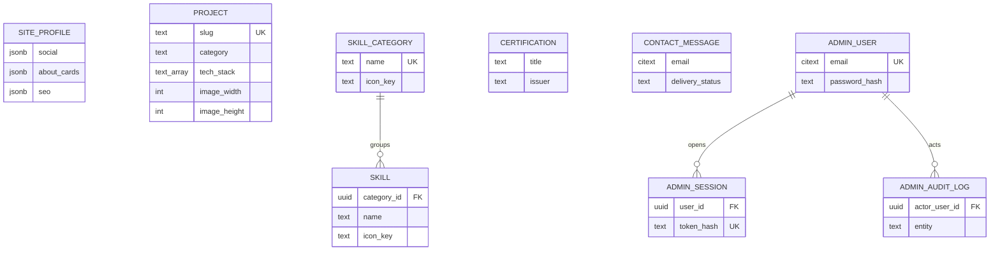

# Database Design

**Document Status:** Active — **Phase 1.5 reviewed; Phase 2 implemented 2026-10-04; Phase 6 content seeding verified 2026-10-06 (§14 revision table reconciled, §14.1 seeding commands, §16 idempotency + zero-diff checks)**
**Document Type:** Data Model Specification
**Version:** 3.1 — Phase 6 seeding reconciled (seed revisions rejected; `db/seed.py` is the loader)
**Last Verified Against Code:** uncommitted working tree (`backend/db/seed.py`, `scripts/extract-content.mjs`, `scripts/compare-content.mjs`)

---

## Reading Convention

| Label | Meaning |
|---|---|
| **CURRENT** | Exists today. |
| **TARGET** | Designed, not yet built. |
| **MIGRATION** | How CURRENT becomes TARGET. |

Architecture rationale: `ARCHITECTURE.md`. Phase plan: `MIGRATION.md`.

---

# 0. Authoritative Answer

> **How many target database tables exist in v1?**

```text
9
```

| # | Table | Rows (seeded) | Independent identity + lifecycle? |
|---|---|---|---|
| 1 | `site_profile` | 1 | yes — the primary aggregate |
| 2 | `project` | 5 | yes — one indexable URL each |
| 3 | `skill_category` | 4 | yes — own icon + order |
| 4 | `skill` | 16 | yes — own icon, ordered, FK-guarded membership |
| 5 | `certification` | 3 | yes — a credential, independently referenced |
| 6 | `contact_message` | 0 | yes — append-only event stream |
| 7 | `admin_user` | 1 | yes — required for auth |
| 8 | `admin_session` | ≤ N | yes — required for revocation |
| 9 | `admin_audit_log` | 0 | yes — the only record of DB edits (§7) |

**This number replaced an earlier inconsistency.** Phase 0 proposed "14 tables"
while enumerating 16 entities. Neither was correct. The error was not an
arithmetic slip — it was that **seven of the sixteen entities should never have
been tables at all.** See §1.

---

# 1. Entity Minimality Review

Phase 1.5 required every proposed entity to answer: *why does this need to
exist, who reads it, who writes it, and can it safely be embedded elsewhere?*

## 1.1 The decision rule

An entity gets its own table **only if all three hold**:

1. **Independent identity** — it has its own natural key, not merely a position
   in a parent list.
2. **Independent lifecycle** — it is created, edited or deleted on its own
   schedule, not only as part of editing its parent.
3. **Independent query** — it is fetched, filtered or sorted apart from its
   parent, or it must be referenceable from elsewhere.

**Failing any one of these, it becomes a structured column on its parent.**

This rule is applied consistently below. It is what turns "14 tables, plus a
few extras" into 9.

## 1.2 Kept as tables

| Entity | Independent identity | Independent lifecycle | Independent query | Verdict |
|---|---|---|---|---|
| `site_profile` | yes — one person | yes — the whole profile page | yes — Hero, Navbar, Footer, `llms.txt` | **Table.** The primary aggregate; 1 row by constraint. |
| `project` | yes — `slug`, one URL each | yes — 5 rows today, ~20 in a year | yes — sitemap, JSON-LD, prerender, `relatedProjects` | **Table.** The core content entity. |
| `skill_category` | yes — `name` | yes — 4 groups, own icon and order | yes — grouped rendering | **Table.** Own metadata (icon) + ordering. |
| `skill` | yes — `(category_id, name)` | yes — the most frequently edited content | yes — grouped by category | **Table.** Own icon per skill; FK guarantees every skill belongs to exactly one category. |
| `certification` | yes — `(title, issuer)` | yes — added as courses complete | yes — own page section | **Table.** A credential is referenced, not merely displayed: its `credential_url` must stay resolvable independently. |
| `contact_message` | yes — appended event | yes — arrives asynchronously | yes — unread-first inbox query | **Table.** An event log, not page furniture. |
| `admin_user` | yes — `email` | yes | yes | **Table.** Required for Argon2id auth. |
| `admin_session` | yes — opaque token hash | yes — per login | yes — per request | **Table.** Required for immediate revocation. |
| `admin_audit_log` | yes — append-only event | yes | yes — "what changed, when" | **Table.** See §7 — the database is not in git, so this is the only history. |

## 1.3 Collapsed into structured columns

Seven entities proposed in Phase 0 fail the rule. Each is removed.

| Proposed entity | Why it was proposed | Why it is not a table | Becomes |
|---|---|---|---|
| `project_technology` | `techStack` is a 3–10 item list per project | No independent identity beyond `(project, name)`. **Never queried across projects** — `relatedProjects()` (`src/lib/projectPages.js:171-185`) intersects two in-memory arrays. Never queried by SQL. | `project.tech_stack text[]` |
| `project_category` | `category` is a filter value | `Projects.jsx` **does not filter by category** — it renders `indexableProjects()` in array order. `relatedProjects()` compares two strings in memory. No SQL query needs it. | `project.category text` |
| `social_link` | 3 links, ordered, each with an icon | The icon is **derived from the platform** in `src/data/socials.js`, so it is code, not data. There is no independent lifecycle and nothing queries it apart from the parent. Also removes an existing duplication with `profile.social`. | `site_profile.social jsonb` (ordered array of `{platform, url}`) |
| `education` | 1 education profile | **There is no education UI.** `About.jsx` has no education entity — the only education text is prose inside `aboutCards[0].description`. A table would drive nothing. | (nothing — see `about_cards`) |
| `about_card` | 4 cards in `About.jsx` | Page furniture: an ordered list with a title, description and icon key, rendered inside the profile section, never queried apart from it. | `site_profile.about_cards jsonb` |
| `blog_post` | 4 rows in `blogs.js` | **All 4 are placeholders** with `status: "Coming Soon"`, `link: "#"` and no body. There is no reading route. A table + 4 CRUD endpoints + an admin screen to edit four "Coming Soon" cards is exactly the CMS complexity this project rejects. | (static — see §9) |
| `redirect` | slug changes break URLs | A CMS redirect manager for a rare event on a 5-row table. Replaced by a stronger invariant: **`slug` is immutable once published** (§8). | (nothing) |

**Net effect: 16 proposed → 9 final.** Seven tables removed, which also removes
seven foreign keys, two join endpoints, one partial unique index, and the
`body_md`-is-null awkwardness.

## 1.4 Considered and rejected (not proposed, still worth recording)

| Option | Verdict |
|---|---|
| Collapse `skill_category` + `skill` into one table with a `skills jsonb` array | **Rejected.** A skill has its own icon; a jsonb array of objects cannot be FK-validated, indexed, or reordered without rewriting the whole array. Two small tables are simpler than one clever one. |
| Store `project` as a single row of JSON | **Rejected.** 5 indexable URLs, a sitemap, per-project canonicals and `relatedProjects()` all need per-row access. |
| Collapse `certification` into `site_profile` jsonb for symmetry with `social` | **Rejected.** Consistency with the wrong precedent. A certification is a credential with a stable key and an external URL; a social link is page furniture. |
| Drop `admin_audit_log` for minimality | **Rejected.** See §7. |

---

# 2. CURRENT Database State

```text
There is no database.
```

Verified, exhaustively:

| Checked | Result |
|---|---|
| `prisma/schema.prisma` | Does not exist |
| Migrations directory | Does not exist |
| SQL / NoSQL client in `package.json` | None |
| `DATABASE_URL` referenced anywhere | No |
| PostgreSQL / MongoDB / Redis / Firebase config | None |
| `ai_service` persistence | **None.** In-memory `_CACHE` dicts (`github.py:33`, chat LLM cache). ChromaDB holds embeddings only — never source-of-truth data. |
| Contact submissions | Emailed via Resend, then **discarded** |

**Any prior claim of a 46-table or 14-table Prisma schema, `User`/`Session`/
`ApiKey` models, Redis caching or migration history was incorrect.**

### 2.1 Where content lives today

| Content | Location | Count | Format |
|---|---|---|---|
| Projects | `src/data/projects.js` | 5 | Static JS objects |
| Skills | `src/data/skills.js` | 4 categories / 16 skills | Static JS + React icon components |
| Profile | `src/data/profile.js` | 1 | Static JS object |
| About section (title, description, heading, 2 paragraphs, 4 cards) | `src/components/sections/About.jsx:14-39,51,73-89` | 1 | Static JS **inside a component** |
| Certifications | `src/data/certificates.js` | 3 | Static JS objects |
| Social links | `src/data/socials.js` | 3 | **Derived** from `profile.social` |
| Blog placeholders | `src/data/blogs.js` | 4 | Static JS, all `status: "Coming Soon"`, `link: "#"` |
| Site SEO config | `src/config/seo.js` | 1 | Static JS object |
| Project page logic | `src/lib/projectPages.js` | — | Derived logic over `projects.js` |
| Image dimensions | `src/lib/projectPages.js:105-111` | 5 | Hardcoded slug→`{width,height}` map |

**Implication:** changing one word requires a developer, an edit and a deploy.
That is the problem this migration solves.

---

# 3. TARGET — Database Selection

| Property | Value |
|---|---|
| **Engine** | PostgreSQL 16 |
| **Hosting** | Managed (Neon / Supabase / Render Postgres — final choice at Phase 2) |
| **ORM** | SQLAlchemy 2.x (async) |
| **Migrations** | Alembic |
| **Validation** | Pydantic v2, `extra="forbid"` |
| **Cache** | None. In-process TTL + HTTP caching only (`ARCHITECTURE.md` ADR-014). |

**Why PostgreSQL** — the deciding constraint is **integrity across the
project/skill/category graph** (ADR-011):

* Foreign keys prevent orphan skills.
* `UNIQUE (slug)` on `project` prevents duplicate canonical URLs.
* `UNIQUE (category_id, name)` on `skill` prevents duplicate badges.
* Filtered, sorted admin queries (`status`, `display_order`, `updated_at DESC`)
  are first-class in SQL.
* `text[]` for `tech_stack` is a native array type; MongoDB would need an
  embedded document array for the same thing.
* `jsonb` for genuinely open shapes (`social`, `about_cards`, `seo`,
  `hero_stats`).

**Why not MongoDB:** defensible (MERN familiarity), but no integrity advantage
here, and harder filtered admin queries.

**Status:** provisional until Phase 2. Phase 1 must not hard-code an ORM choice
that forecloses PostgreSQL.

### 3.1 Sizing

| Metric | Current | Expected in 12 months |
|---|---|---|
| Projects | 5 | ≤ 20 |
| Skill categories / skills | 4 / 16 | ≤ 6 / 30 |
| Certifications | 3 | ≤ 12 |
| Contact messages | 0 | ≤ 500 |
| Admin users | 1 | 1–3 |
| Admin sessions | 0 | ≤ 5 |
| Audit rows | 0 | ≤ 2000 |

**Under 20 MB.** One small managed instance. No replicas, no sharding, no
partitioning.

---

# 4. TARGET — Entity Model



**Relationships: 3 foreign keys, all `admin_*` or `skill`.**

`site_profile`, `project` and `certification` have **no foreign keys** — they
are roots, and everything that used to hang off `project` is now a column on it
(§1.3).

---

# 5. TARGET — Schema

Conventions: PostgreSQL types; `timestamptz` for all timestamps;
`gen_random_uuid()` (PG 13+) for PKs; `citext` for email; `jsonb` only where
noted; `created_at` / `updated_at` on every table.

## 5.1 `site_profile` — 1 row

| Column | Type | Constraints | Public key | Notes |
|---|---|---|---|---|
| `id` | `uuid` | PK, default `gen_random_uuid()` | — | |
| `singleton` | `boolean` | NOT NULL, default `true`, **UNIQUE** | — | Makes a 2nd row impossible |
| `name` | `text` | NOT NULL | `name` | |
| `title` | `text` | NOT NULL | `title` | `Full Stack Developer` |
| `greeting` | `text` | | `greeting` | Hero eyebrow, incl. emoji |
| `roles` | `text[]` | NOT NULL, default `{}` | `roles` | Hero rotating roles |
| `available_for_internship` | `boolean` | NOT NULL, default `false` | `availableForInternship` | Gates the Hero badge |
| `internship_text` | `text` | | `internshipText` | Badge label |
| `description` | `text` | | `description` | Hero paragraph |
| `location` | `text` | | `location` | |
| `resume` | `text` | NOT NULL | `resume` | Public resume link: `/Ritu_..._Resume.pdf`, or `/api/resume` once an admin uploads one |
| `resume_key` | `text` | nullable | — | Object key of the uploaded resume in the **private** `uploads` bucket (`resumes/<uuid4>.pdf`); server-generated, never public. `NULL` serves the in-repo PDF. Migration `0004_profile_resume_key`. |
| **`stats`** | **`jsonb`** | NOT NULL, default `'[]'` | `stats` | `[{label, value}]`, 3 rows |
| **`social`** | **`jsonb`** | NOT NULL, default `'{}'` | `social` | **`{github, linkedin, email}`** — byte-identical to today. Replaces `social_link`. |
| **`about`** | **`jsonb`** | NOT NULL, default `'{}'` | `about` | **`{tag, title, description, heading, paragraphs[], cards[]}`.** Replaces `about_card`. |
| **`seo`** | **`jsonb`** | NOT NULL, default `'{}'` | `seo` | Content keys of `src/config/seo.js` (§5.1.1) |
| `created_at` / `updated_at` | `timestamptz` | NOT NULL, default `now()` | — | |

**18 columns** — the 16 rows above plus `created_at` and `updated_at`. Every one
has a verified consumer in the current code. `resume_key` was added in Phase 11
(migration `0004_profile_resume_key`) so the profile can point at an uploaded
resume without making `resume` anything other than a public link; it is
deliberately **not** exposed by `GET /api/content`.

### 5.1.1 Four columns were deliberately *not* added

Phase 0 proposed `avatar`, `bio`, `phone`, `email`, `availability`,
`tech_stack`, `hero_stats`, `about_text` and a `profile.seo` block. Reading
`src/data/profile.js` and `src/components/sections/About.jsx` shows most of
these do not exist:

| Proposed column | Reality | Decision |
|---|---|---|
| `avatar` | `profile.js:1,43` does `import profileImage from "../assets/images/ritu.webp"` — a **Vite asset import**, consumed at `Hero.jsx:145`. It resolves to a content-hashed URL. | **No column.** An asset reference, not content. Stays the code import. |
| `bio` | The field is called `description` (`profile.js:21`, read at `Hero.jsx:83`). | Column named `description`. No `bio`. |
| `hero_stats` | The key is `stats` (`profile.js:59`, read at `Hero.jsx:94`). | Column named `stats`. No rename. |
| `resume_path` | The key is `resume` (`profile.js:37`). | Column named `resume`. No rename. |
| `phone` | **Not in `profile.js`.** No consumer. | **No column.** |
| `email` | **Not top-level in `profile.js`.** Lives at `profile.social.email` (`profile.js:52`). | **No column.** Already in `social`. |
| `availability` | **Not in `profile.js`.** The real keys are `availableForInternship` + `internshipText`. | Replaced by those two columns. |
| `tech_stack` (profile) | `profile.js:78` defines `profile.techStack`, and **nothing reads it** — every `techStack` consumer is `project.techStack` (`ProjectCard.jsx:22`, `ProjectPage.jsx:35`). | **No column.** Dead data, deleted during migration. |
| `about_text` | About prose is 1 `description` + a `heading` + **2 `<p>` paragraphs** + 4 cards (`About.jsx:51,73-89`). A single `text` column cannot hold that shape. | Replaced by the structured `about` jsonb column. |

**`profile.seo` is dead data.** `profile.js:92-111` defines a nested
`{title, description, keywords}` object, and `grep -rn "profile\.seo"` returns
**no matches** anywhere in `src/` or `scripts/`. The live site SEO is
`src/config/seo.js`, a separate object. So `profile.seo` is not migrated — it
is deleted, and `site_profile.seo` carries the real one.

### 5.1.2 Why `social` keeps today's exact shape

Phase 0 proposed an **ordered array** `[{platform, url}]` with a client-side
icon registry. That was wrong, and reading `src/data/socials.js` proves it:

```js
// src/data/socials.js:9-25  — this file is CODE, not data
const socials = [
    { name: "GitHub",  url: profile.social.github,  icon: FaGithub   },
    { name: "LinkedIn", url: profile.social.linkedin, icon: FaLinkedin },
    { name: "Email",    url: `mailto:${profile.social.email}`, icon: FaEnvelope },
];
```

**Order and icons are already hardcoded in a module that imports `react-icons`.**
An ordered array in the database would have required rewriting `socials.js` and
adding an icon registry, to move data that was never data.

So `site_profile.social` stores the **object** `{github, linkedin, email}` —
byte-identical to `profile.js:49-53`. `socials.js` is **untouched**. This is
also the strongest argument for dropping the `social_link` table: the rows
would have owned only the three URLs, while the ordering, the display names and
the icons all lived in code regardless.

### 5.1.3 How `site_profile.seo` splits from `src/config/seo.js`

`src/config/seo.js` is read by the build for 17 keys. They split cleanly by
*who owns the value*:

| Keys | Owner | Where |
|---|---|---|
| `siteName`, `title`, `description`, `keywords`, `author`, `image`, `imageAlt`, `twitterSite`, `person` (all 6 sub-keys), `sameAs`, `robots`, `locale`, `type`, `twitterCard` | **The person** → content | `site_profile.seo` (DB) |
| `url` | **The domain** → deployment config | stays in `seo.js` |
| `verification` (google, bing) | **The domain** → owner config, only meaningful alongside `url` | stays in `seo.js` |

`seo.url` is `https://riturajlabs.vercel.app/` — a property of where the site is
deployed, not of the person. Making it database content would mean a content edit
could silently point every canonical tag, the sitemap and `llms.txt` at the wrong
host. It stays static, in the same spirit as `SITE_URL` (`ARCHITECTURE.md` §6).

**`seo.sameAs` duplicates `social`.** It currently holds the GitHub and LinkedIn
URLs, i.e. exactly `social.github` and `social.linkedin`. To avoid two sources
for one fact, `sameAs` is **derived from `social`** in the repository layer and
is **not** stored. Only `social.twitterSite` is stored, because the X handle is
not derivable from a URL.

### 5.1.4 Why `about` is one jsonb column

`About.jsx` renders six pieces of text from two locations — a hardcoded
`description` prop at `:51`, a `heading` and two `<p>` paragraphs at `:73-89`, and
the `aboutCards` array at `:14-39`. All of it is one page section with one
lifecycle, never queried apart, and never referenced from anywhere else. Under
the §1.1 rule that is a structured column, not six tables.

The `cards` array stores `icon_key` (e.g. `FaGraduationCap`) instead of the React
component, because a component cannot be serialised (ADR-008).

**This requires new code, and the documentation must say so.** Today
`About.jsx:3-8` imports its four icons directly, and `skills.js:25-110` stores
`icon: FaReact` — actual component references. `grep -rn "icon_key" src/` returns
**zero matches**: the string `icon_key` does not exist anywhere in the codebase
yet.

So Phase 5 creates a single new module — a flat `iconKey → component` registry
covering the 4 About icons, 4 category icons and 16 skill icons — and rewires
`skills.js` and `About.jsx` to read through it. That is **new work created by the
serialisation requirement**, not a refactor of something that already exists, and
it is the only component change in Phase 5. It is bounded and reviewable: one new
file, plus import swaps in two files.

## 5.2 `project` — 5 rows

| Column | Type | Constraints | Notes |
|---|---|---|---|
| `id` | `uuid` | PK | |
| `slug` | `text` | NOT NULL, UNIQUE, `CHECK (slug ~ '^[a-z0-9]+(-[a-z0-9]+)*$')`, ≤ 80 | **Immutable once published** (§8) |
| `title` | `text` | NOT NULL | |
| `short_description` | `text` | NOT NULL | Card text |
| `long_description` | `text` | | Project page body |
| `image` | `text` | NOT NULL, `CHECK (image ~ '^/images/projects/[a-z0-9-]+\.webp$')` | **Build contract** |
| `image_width` | `integer` | NOT NULL, `CHECK (> 0)` | Replaces `PROJECT_IMAGE_DIMENSIONS` |
| `image_height` | `integer` | NOT NULL, `CHECK (> 0)` | |
| `image_alt` | `text` | NOT NULL | a11y |
| **`category`** | **`text`** | ≤ 60 | **Replaces `project_category`** |
| **`tech_stack`** | **`text[]`** | NOT NULL, default `{}` | **Replaces `project_technology`** |
| `status` | `text` | NOT NULL, default `'published'`, `CHECK IN ('published','hidden')` | See §8 |
| `featured` | `boolean` | NOT NULL, default `false` | 2 currently true |
| `indexable` | `boolean` | NOT NULL, default `true` | Drives sitemap inclusion |
| `display_order` | `integer` | NOT NULL, default `0` | Preserves `projects.js` array order |
| `live_url` | `text` | | `live` field |
| `github_url` | `text` | | `github` field |
| `seo_title` | `text` | NOT NULL, ≤ 70 | Per-project SEO title |
| `seo_description` | `text` | NOT NULL, ≤ 185 | |
| `created_at` / `updated_at` | `timestamptz` | NOT NULL, default `now()` | |

**Three columns carry build-critical contracts. All three are CHECK-enforced so
an invalid value cannot be stored:**

1. **`image`** — `generate-project-pages.mjs:207-218` requires
   `project.image === /images/projects/<slug>.webp`.
2. **`image_width` / `image_height`** — `projectImageDimensions()`
   (`src/lib/projectPages.js:117-127`) throws for a slug with no entry, and the
   generator cross-checks the values against the **real WebP header**. A CMS
   insert without correct dimensions would break the production build. Moving
   the numbers into the database removes the manual `PROJECT_IMAGE_DIMENSIONS`
   edit; keeping the cross-check keeps the guarantee (§10).
3. **`seo_title` / `seo_description`** — `discover.mjs` asserts both exist.

**`featured` and `indexable` are independent.** Two projects are featured; all
five are indexable. `Projects.jsx` renders `indexableProjects()` in array order,
so `display_order` must preserve the seeded order exactly or the homepage grid
reorders silently.

**`status` is deliberately two-valued, not three** — see §8.

## 5.3 `skill_category` — 4 rows

| Column | Type | Constraints |
|---|---|---|
| `id` | `uuid` | PK |
| `name` | `text` | NOT NULL, UNIQUE |
| `icon_key` | `text` | NOT NULL | Key resolved via the Phase 5 registry (§5.1.4) |
| `display_order` | `integer` | NOT NULL, default `0` |
| `is_visible` | `boolean` | NOT NULL, default `true` |
| `created_at` / `updated_at` | `timestamptz` | |

Rows: `Frontend Development`, `Backend Development`, `AI & Machine Learning`,
`Database & Tools`.

## 5.4 `skill` — 16 rows

| Column | Type | Constraints |
|---|---|---|
| `id` | `uuid` | PK |
| `category_id` | `uuid` | FK → `skill_category(id)` ON DELETE CASCADE, NOT NULL |
| `name` | `text` | NOT NULL, ≤ 60 |
| `icon_key` | `text` | NOT NULL | Key resolved via the Phase 5 registry (§5.1.4) |
| `display_order` | `integer` | NOT NULL, default `0` |
| `is_visible` | `boolean` | NOT NULL, default `true` |
| `created_at` / `updated_at` | `timestamptz` | |

**Unique** `(category_id, name)`. The FK is the reason this is a table and not a
jsonb array on the category (§1.4).

## 5.5 `certification` — 3 rows

| Column | Type | Constraints |
|---|---|---|
| `id` | `uuid` | PK |
| `title` | `text` | NOT NULL |
| `issuer` | `text` | NOT NULL |
| `icon` | `text` | Emoji (`🌐`, `🐍`, `🤴`) — preserved as-is |
| `issued_on` | `text` | Free text, matches CURRENT format |
| `credential_id` | `text` | |
| `credential_url` | `text` | |
| `display_order` | `integer` | NOT NULL, default `0` |
| `created_at` / `updated_at` | `timestamptz` | |

`issued_on` is `text`, not `date`, because the current values are
`"June 2025"`-style display strings.

## 5.6 `contact_message`

| Column | Type | Constraints |
|---|---|---|
| `id` | `uuid` | PK |
| `name` | `text` | NOT NULL, `CHECK (char_length BETWEEN 2 AND 100)` |
| `email` | `citext` | NOT NULL, `CHECK (char_length <= 254)` |
| `subject` | `text` | NOT NULL, `CHECK (char_length BETWEEN 3 AND 150)` |
| `message` | `text` | NOT NULL, `CHECK (char_length BETWEEN 10 AND 2000)` |
| `status` | `text` | NOT NULL, default `'unread'`, `CHECK IN ('unread','read','archived')` |
| `delivery_status` | `text` | NOT NULL, default `'pending'`, `CHECK IN ('pending','sent','failed')` |
| `source_ip_hash` | `text` | SHA-256 of IP + daily salt — **never the raw IP** |
| `user_agent` | `text` | Truncated to 300 |
| `created_at` | `timestamptz` | NOT NULL, default `now()` |

**Index** `(status, created_at DESC)` — the inbox query.

**The raw IP is never stored.** A keyed, daily-rotating HMAC of the address is
enough to rate limit and to spot floods, and avoids retaining personal data.

**`delivery_status` is written before the Resend call**, so a Resend outage
loses nothing: the row exists with `failed` (`API.md` §4.3).

**No hard delete.** Messages are read-only and archivable.

## 5.7 `admin_user` — 1 row

| Column | Type | Constraints |
|---|---|---|
| `id` | `uuid` | PK |
| `email` | `citext` | NOT NULL, UNIQUE |
| `password_hash` | `text` | NOT NULL | Argon2id, PHC string |
| `role` | `text` | NOT NULL, default `'ADMIN'`, `CHECK (role = 'ADMIN')` |
| `is_active` | `boolean` | NOT NULL, default `true` |
| `failed_attempts` | `integer` | NOT NULL, default `0` | |
| `locked_until` | `timestamptz` | | |
| `last_login_at` | `timestamptz` | | |
| `created_at` / `updated_at` | `timestamptz` | NOT NULL |

## 5.8 `admin_session`

| Column | Type | Constraints |
|---|---|---|
| `id` | `uuid` | PK |
| `user_id` | `uuid` | FK → `admin_user(id)` ON DELETE CASCADE, NOT NULL |
| `token_hash` | `text` | NOT NULL, UNIQUE | SHA-256 of the opaque token |
| `issued_at` | `timestamptz` | NOT NULL, default `now()` |
| `last_used_at` | `timestamptz` | NOT NULL, default `now()` | 12 h idle timeout |
| `expires_at` | `timestamptz` | NOT NULL | 7 d absolute |
| `revoked_at` | `timestamptz` | | Non-null ⇒ invalid |
| `ip_hash` | `text` | |
| `user_agent` | `text` | Truncated to 300 |

**Only the hash is stored.** A database dump cannot be replayed as a session.
Logout sets `revoked_at` — revocation is immediate, not eventual.

## 5.9 `admin_audit_log`

| Column | Type | Constraints |
|---|---|---|
| `id` | `uuid` | PK |
| `actor_user_id` | `uuid` | FK → `admin_user(id)` ON DELETE SET NULL |
| `action` | `text` | NOT NULL | `create`/`update`/`delete`/`login`/`logout` |
| `entity` | `text` | NOT NULL | Table name |
| `entity_id` | `text` | | |
| `before` | `jsonb` | | Prior state |
| `after` | `jsonb` | | New state |
| `at` | `timestamptz` | NOT NULL, default `now()` |

**Append-only.** No `UPDATE` or `DELETE` grant. Never surfaced publicly.
Passwords and tokens are never written to `before`/`after`.

---

# 6. Source of Truth Rule

```text
                    ┌─────────────────────────────┐
   admin writes ──▶ │  PostgreSQL                 │ ◀── build reads
                    │  THE AUTHORITATIVE SOURCE   │ ◀── ai_service reads
                    └─────────────────────────────┘
                                  │
                       generate-project-pages.mjs
                       generate-seo-discovery.mjs
                                  ▼
                    src/data/fallbackSnapshot.js
                    (GENERATED at build time, never hand-edited)
```

**Rules**

1. **PostgreSQL is the only editable source of portfolio content.** A content
   change is made in the admin dashboard, never in a file.
2. **`src/data/*.js` becomes a build artifact, not a source.** After Phase 7 it
   is regenerated from the API on every build and committed only as a rollback
   snapshot.
3. **No developer is ever instructed to edit both.** There is exactly one place
   content changes, and it is the admin UI.
4. **`knowledge_base.json` follows the same rule** — it becomes a generated
   snapshot or is deleted (`ARCHITECTURE.md` ADR-006).
5. **The fallback snapshot is never a second source of truth** because it cannot
   be hand-edited without failing `seed:verify`
   (`MIGRATION.md` Phase 7).

**Deliberately static, and therefore not in violation of rule 1:**

| Static asset | Why it is not content |
|---|---|
| Navbar / footer link arrays | Layout, not content. Fixed single-page structure |
| `src/config/seo.js` **site constants** (`SITE_URL`, `PROJECTS_LIST_PATH`) | Deployment configuration, not content. Values that belong to the DB are in `site_profile.seo` |
| **Blog placeholders** | No post exists. See §9 |
| `public/**` (images, resume, favicons) | Binary assets. §10 |
| `scripts/**` validators | Build logic |

---

# 7. Why `admin_audit_log` Is Required in v1

This is the one table whose necessity is not obvious, so it is justified
explicitly.

**Before the migration**, every content change is a git commit. `git log` is a
complete, authoritative history of every edit to every content file, authored
and timestamped, with diffs.

**After the migration, that guarantee disappears.** The database is not in git.
An admin edit changes:

* nothing in `src/data/*.js`
* nothing in the repository
* nothing in the Vercel deployment history (the next deploy is a no-op content-wise)

So without `admin_audit_log`, this question becomes **unanswerable**: *a visitor
reports that a project description is wrong — who changed it, when, and from
what?* There is no record anywhere in the system.

`admin_audit_log` restores the guarantee that the migration removes. It is
therefore not optional admin polish; it is **load-bearing for the source-of-truth
rule in §6.**

**The minimal viable version** — `actor_user_id`, `action`, `entity`,
`entity_id`, `after`, `at` — would suffice. `before` is retained because for a
single admin "what did it used to say?" is the more common question.

**Not retained:** a `changed_fields` column. `before`/`after` diffing is a
client concern and does not justify a column.

---

# 8. Publishing Workflow — Final Decision

### 8.1 v1 has **no** draft/publish workflow

Phase 0 proposed `status ∈ ('draft','published','archived')` on `project` and
`blog_post`. **This is withdrawn.** It was a CMS convention imported by
analogy, not a requirement of this site.

**Requirement analysis:**

| Driver for draft/publish | Present here? |
|---|---|
| An editor other than the author | No — one owner |
| Scheduled publication | No |
| Review/approval workflow | No |
| Version history of revisions | Covered by `admin_audit_log` |
| Hiding half-written content from visitors | **No — see below** |

The last row is the only plausible driver, and it fails: `project.indexable`
already exists and already controls whether a project gets a page, a sitemap
entry and an image-sitemap entry. `indexable: false` **is** the hide mechanism,
and it exists today.

**Final model — two states, two independent flags:**

| Concept | Column | Effect |
|---|---|---|
| Visible on the site | `status` (`'published'` \| `'hidden'`) | Excluded from the public API when `hidden` |
| Gets an indexable page | `indexable` (`true` \| `false`) | Excluded from prerender, `sitemap.xml`, `sitemap-images.xml` and `llms.txt` |

A project is fully private by setting `status='hidden'`. It stays public but
carries no SEO weight by setting `indexable=false` — which is exactly the
distinction `src/lib/projectPages.js:140-160` already implements.

**Both flags are required.** `indexable` alone cannot hide a project (it still
renders on the homepage); `status` alone cannot remove it from the sitemap
without also removing its page.

**`archived` is withdrawn.** Soft delete is expressed as `status='hidden'` plus
`indexable=false`. A third state would have added a rule to every read query for
no additional capability.

### 8.2 The end-to-end content flow

```text
   Admin dashboard  ──PUT──▶  PostgreSQL        ← the change is now authoritative
                              (immediately)
                                  │
                                  ▼
                    ┌─────────────────────────────┐
                    │  npm run build  (explicit)  │
                    │                             │
                    │  fetch GET /api/content    │
                    │    ├─ fail ──▶ BUILD FAILS  │  (loud, never silent)
                    │    └─ ok                      │
                    │  validate: schema, slugs,   │
                    │  image dims vs real files,  │
                    │  SEO fields, sitemap sanity │
                    │  prerender 5 project pages  │
                    │  emit 4 discovery files     │
                    │  write fallback snapshot     │
                    └─────────────────────────────┘
                                  │
                                  ▼
                    Vercel atomic deployment  ──▶  public content
                                  │
                                  ▼
                    ai_service reindexes from the API (Phase 9)
```

**Explicit statement required by the review:**

> Editing content in the admin dashboard **does not** imply request-time
> database rendering of the public site. The public portfolio stays
> static/prerendered for performance, SEO, CDN delivery and failure isolation.
> A content change becomes public after an explicit `npm run build` and deploy.

### 8.3 Build trigger

**v1 trigger: explicit.** The admin save button offers a "Rebuild site" action
that calls the Vercel deploy hook. It is a button the owner can ignore, not an
automatic pipeline.

Automatic rebuild-on-write is explicitly out of scope. Rationale: a failed build
would leave the deployed site serving content that no longer matches the
database — a state that is harder to reason about than a manual deploy.

---

# 9. Blog Scope — Final Decision

```text
Blog metadata       = STATIC in v1  (src/data/blogs.js)
Blog reading route  = DEFERRED
blog_post table     = REMOVED from v1
```

**Why.** `src/data/blogs.js` contains 4 objects, and every one has
`status: "Coming Soon"` and `link: "#"`. There is:

* no `/blog/:slug` route
* no post body
* no reader

A `blog_post` table would add a 10th table, 4 CRUD endpoints, an admin screen,
a partial unique index and a `body_md` column that is `NULL` for 100% of rows —
to manage four strings that render as "Coming Soon" cards.

**This does not violate the source-of-truth rule (§6).** The blog section is
page furniture, in the same category as the navbar link array: there is no
content to manage because no content exists.

**Trigger to change.** When the first real post is written, one approved change
introduces, together: the `blog_post` table with a non-null `body_md`, the
`/blog/:slug` route, blog sitemap entries, and a `BlogPost` SEO entity. They
are one feature and must not be split — a reading route with no body, or a body
with no route, is a second product.

**Consequence to accept:** the four placeholder cards cannot be edited from the
admin dashboard in v1. Their titles are announced topics, not published content.

---

# 10. Image Strategy — Final Decision

**No media table. No media entity in the schema. No upload endpoint in v1.**
(Amended 2026-10-14: `POST /api/admin/uploads` now stores a project cover image
in object storage; see the update at the end of this section.)

`public/` holds 5 project WebP files, 1 portrait, 1 resume PDF, favicons and an
OG image — all committed, all immutable, all served with 1-year immutable cache
headers. An upload pipeline would break the
`image === /images/projects/<slug>.webp` contract that
`generate-project-pages.mjs:212` enforces and would add file-type, size,
path-traversal and malware handling for no current benefit.

**The minimal schema change that removes the hidden build dependency:**

| Before | After |
|---|---|
| Developer adds a project to `projects.js` | Admin adds a project |
| …and **must** also edit `PROJECT_IMAGE_DIMENSIONS` (`projectPages.js:105-111`) or the build throws | Dimensions are columns on `project` |
| …and **must** also drop a correctly-named WebP into `public/images/projects/` | Still required — see below |

So: **two integer columns, `image_width` and `image_height`.** Nothing else
changes. No media entity, no upload path, no object store. (The 2026-10-14 update
below adds an upload path to object storage, but still no media entity and no
schema column beyond the two integers.)

**The real-file verification is retained, not weakened.** The build still reads
the WebP container header (`readWebpSize()`, `generate-project-pages.mjs:42-107`)
and still fails if the stored dimensions disagree with the file
(`:264-293`). `PROJECT_IMAGE_DIMENSIONS` survives as a **derived** map
constructed from the fetched snapshot, keeping `projectImageDimensions()`
(`projectPages.js:117-127`) and its throw-on-missing behaviour intact.

Net effect: the developer-only constant becomes DB data, and the build's
existing guarantee gets *stronger* because the values are now CHECK-constrained
at write time instead of hand-maintained.

**Trigger to revisit:** an explicit requirement to upload images from the admin
UI. Recorded in `MIGRATION.md` §3 as deferred.

**Update (2026-10-14) — trigger fired, decision narrowed.** The owner asked for
project-image upload from the admin UI, so the decision is amended, not reversed:

* `POST /api/admin/uploads` stores a cover image in S3-compatible object storage
  (Neon Object Storage) and returns its **public URL** plus the **server-measured**
  width/height.
* `project.image` now accepts that URL *or* the original
  `/images/projects/<slug>.webp` path. The `image_path` CHECK is extended in
  migration `0003_project_image_url`; the old path form and every existing row are
  unchanged.
* Still **no media table and no new column**: an uploaded image is still just the
  three columns `image`, `image_width`, `image_height`. The object's key lives in
  the URL, and the audit row (`entity='upload'`) records the key separately.
* The build verification is retained: for a URL image the `readWebpSize()` check is
  skipped (there is no local file) and the persisted dimensions are the reference;
  for a path image the WebP header is still read and compared.

Regenerate and roll back with `alembic upgrade head` / `alembic downgrade
0002_certification_unique` (`docs/MIGRATION.md` §10). The downgrade restores the
path-only CHECK and therefore fails if a row already holds a URL — intentionally,
since silently rewriting the owner's uploaded image would lose it.

---

# 11. Data Contract

The public API payload must mirror the current JS module shapes exactly, so
component props do not change (`API.md` §4.2).

## 11.1 The mapping rule

There is exactly one transformation layer, and it is `backend/`.

| Kind | Rule | Where |
|---|---|---|
| **Scalar column** | `snake_case` in Postgres → `camelCase` in the public JSON | `backend/repositories/` only |
| **`jsonb` column** | JSON keys inside the object are already `camelCase` and match the public payload byte-for-byte — no transformation | none needed |
| **Derived value** | Computed in the repository, never stored (§5.1.3) | `backend/repositories/` only |

**The frontend contains no mapper.** That is the point: `Hero.jsx`,
`ProjectCard.jsx`, `Navbar.jsx` and `About.jsx` keep reading
`profile.stats`, `project.techStack`, `profile.social` and `card.icon_key`
exactly as they do today.

## 11.2 Column → payload key

| DB column | Public JSON key | Verified source |
|---|---|---|
| `site_profile.name` | `profile.name` | `profile.js:8` |
| `site_profile.title` | `profile.title` | `profile.js:10` |
| `site_profile.greeting` | `profile.greeting` | `profile.js:19` |
| `site_profile.roles` | `profile.roles` | `profile.js:12` |
| `site_profile.available_for_internship` | `profile.availableForInternship` | `profile.js:28` → `Hero.jsx:50` |
| `site_profile.internship_text` | `profile.internshipText` | `profile.js:29` → `Hero.jsx:54` |
| `site_profile.description` | `profile.description` | `profile.js:21` → `Hero.jsx:83` |
| `site_profile.location` | `profile.location` | `profile.js:33` |
| `site_profile.resume` | `profile.resume` | `profile.js:37` |
| `site_profile.stats` | `profile.stats` | `profile.js:59` → `Hero.jsx:94` |
| `site_profile.social` | `profile.social` | `profile.js:49-53` → `socials.js:12-22` |
| `site_profile.about` | `about` | `About.jsx:14-39,51,73-89` |
| `site_profile.seo` | `seo` | `src/config/seo.js` |
| *(derived from `social`)* | `seo.sameAs` | `seo.js:232-239` |
| `project.slug` | `projects[].slug` | `projects.js` |
| `project.title` | `projects[].title` | `projects.js` |
| `project.short_description` | `projects[].description` | **key kept** |
| `project.long_description` | `projects[].longDescription` | **key kept** |
| `project.image` | `projects[].image` | build contract, §13 |
| `project.image_alt` | `projects[].imageAlt` | **key kept** |
| `project.live_url` | `projects[].live` | **key kept** |
| `project.github_url` | `projects[].github` | **key kept** |
| `project.seo_title` | `projects[].seoTitle` | **key kept** |
| `project.seo_description` | `projects[].seoDescription` | **key kept** |
| `project.category` | `projects[].category` | **key kept** |
| `project.tech_stack` | `projects[].techStack` | `text[]` → `string[]` |
| `project.image_width` / `image_height` | `projects[].image_width` / `image_height` | new; build-only |
| `project.status` / `indexable` / `featured` / `display_order` | same names | — |
| `skill_category.name` / `display_order` | `skills[].category.name` / `.display_order` | nested, matches today |
| `skill_category.icon_key` | `skills[].category.icon_key` | `skills.js:37` — **`icon` → `icon_key`** |
| `skill.name` / `icon_key` / `display_order` | `skills[].name` / `skills[].icon_key` / `.display_order` | `skills.js:29` — **`icon` → `icon_key`** |
| `certification.*` | `certifications[]` | **keys unchanged** |
| — | `blog_posts[]` | **absent in v1** — §9 |

## 11.3 The two deliberate key exceptions

`image_width` / `image_height` are the only snake_case keys in the payload. They
are consumed **only** by `scripts/generate-project-pages.mjs`, never by a
component, so matching the DB spelling avoids a mapping that has no consumer.

`projects[].highlights` is read by `ProjectCard.jsx` and `ProjectPage.jsx`. It is
seeded from `projects.js` but has **no column**: it is a list of bullet strings
inside the long description's domain, not independently queried. It is derived in
the repository alongside `seo.sameAs`. **If a future requirement needs per-bullet
ordering or filtering, it becomes a column then.**

## 11.4 Rules

1. **Public keys match today's JS modules, including camelCase.** The frontend
   needs no mapper; the repository layer owns all renames.
2. **Keys are never removed**, even when the underlying data is dead
   (`profile.seo`, `profile.techStack`) — the keys are *deleted* from the payload
   only if they are deleted from `profile.js` in the same change, so the two stay
   in lockstep.
3. `extra="forbid"` on every response model, so a typo in a repository becomes a
   `500` in tests rather than a silently missing field in production.
4. **A snapshot test asserts the payload key set equals the JS module key set**
   for every surviving entity (`TESTING.md` §7.1). This test is what stops the
   two representations from drifting, and it is mandatory before Phase 6.

---

# 12. Query Patterns and Indexes

| Query | Used by | Index |
|---|---|---|
| Published projects, ordered | Homepage, build, AI | `project (status, display_order)` |
| Indexable published projects | `sitemap.xml`, `llms.txt` | `project (status, indexable)` |
| Project by slug | Build validation | `project (slug)` UNIQUE |
| Featured projects | Homepage highlight | `project (status, featured)` |
| Visible skill categories | Homepage | `skill_category (is_visible, display_order)` |
| Skills in a category | Homepage | `skill (category_id, is_visible, display_order)` |
| Certifications ordered | Homepage | `certification (display_order)` |
| Admin list, filtered + sorted | Admin UI | `(status, updated_at DESC)` per entity |
| Inbox: unread first | Admin | `contact_message (status, created_at DESC)` |
| Session lookup by token | Every admin request | `admin_session (token_hash)` UNIQUE |
| Session cleanup | Cron | `admin_session (expires_at)` |
| Audit trail by entity | Admin | `admin_audit_log (entity, entity_id, at DESC)` |

**No full-text search, no `pg_trgm`, no GIN indexes.** A site with 5 projects
does not need them. Revisit only above ~200 entries.

**`tech_stack` is not indexed.** Nothing queries it in SQL — `relatedProjects()`
intersects two in-memory arrays at build time (§1.3).

**Two rows above are satisfied by a unique index, not a separate one.**
`project (slug)` and `admin_session (token_hash)` are UNIQUE columns, and
PostgreSQL backs a UNIQUE constraint with a unique index. A second, non-unique
index on the same column would slow writes and buy nothing.

---

# 13. Data Integrity Constraints

| Constraint | Mechanism | Prevents |
|---|---|---|
| One profile row | `singleton boolean UNIQUE DEFAULT true` | A duplicate profile from a race |
| Valid slug | `CHECK (slug ~ '^[a-z0-9]+(-[a-z0-9]+)*$')` | Broken URLs, path traversal |
| Slug uniqueness | `UNIQUE (slug)` | Duplicate canonical URLs |
| Image path contract | `CHECK (image ~ '^/images/projects/[a-z0-9-]+\.webp$')` | **Build breakage** |
| Image dimensions > 0 | `CHECK (> 0)` | `generate-project-pages.mjs` failing |
| Status enum | `CHECK (status IN ('published','hidden'))` | Invalid states reaching the API |
| SEO fields always present | Both NOT NULL with no default | A build-time assertion failure at 2 a.m. instead of at write time |
| Skill uniqueness | `UNIQUE (category_id, name)` | Duplicate badges |
| Certification uniqueness | `UNIQUE (title, issuer)` | Duplicate certification rows |
| No orphan skills | FK `category_id` ON DELETE CASCADE | A skill with no category |
| Contact length limits | `CHECK (char_length ...)` | Oversized payloads at rest |
| Role is single | `CHECK (role = 'ADMIN')` | Accidental partial RBAC |
| Session expiry | `expires_at NOT NULL` | Sessions that never expire |

---

# 14. Migration Strategy

**Alembic. One revision per phase group. Never edit an applied revision.**

| Revision | Phase | Contents |
|---|---|---|
| `0001_initial` | 2 | **APPLIED.** All 9 tables, indexes, CHECKs, `citext` extension |
| `0002_certification_unique` | 7 | **APPLIED.** Adds `certification (title, issuer)` UNIQUE (§5.5, §13) |
| `0003_project_image_url` | Neon | **APPLIED.** Drops and recreates `ck_project_image_path` so `project.image` also accepts an absolute `http(s)` object-storage URL (§10 update, ADR-012). No column, no data |
| ~~`0002_seed_reference`~~ | 6 | **REJECTED in Phase 6.** Seed data is not schema, and an applied data revision never re-runs, so it cannot be idempotent. Loading is `backend/db/seed.py` / `npm run seed:load` (§14.1) |
| ~~`0003_seed_content`~~ | 6 | **REJECTED in Phase 6.** Same reason — 5 projects and the `site_profile` row come from `npm run seed:load` |
| `0004_create_admin` | 4 | First `admin_user` row (table already exists) — still planned, not applied |
| `0005_contact_message` | 8 | `contact_message` wiring (table already exists) — still planned, not applied |

**9 tables, 3 applied revisions + 2 planned** (`0001_initial`,
`0002_certification_unique` and `0003_project_image_url` applied; `0004`
and `0005` deferred to their phases; the two Phase 6 seed revisions rejected —
the table above keeps their rows struck through so the decision is visible).
(Phase 0 proposed 6 revisions including one for a
`redirect` table that no longer exists.) The last two revisions originally had to
create their tables; `0001_initial` already has them, so they are data-only from
here — see §16.1.

## 14.1 Seeding — `MIGRATION.md` Phase 6

**None of this is an Alembic revision.** The seed lives in `backend/db/seed.py`,
not in `0002`/`0003` (rejected — see §14): loading content must be re-runnable
and idempotent, which an applied data revision cannot be. Alembic owns schema;
the seed owns rows.

```bash
npm run seed:extract     # src/data/*.js + About.jsx → .cache/content-snapshot.json
npm run seed:load        # .cache/content-snapshot.json → PostgreSQL (idempotent)
npm run seed:verify      # field-by-field diff: API response vs snapshot
```

**Rules**

1. **Idempotent** — running twice produces identical rows. Upsert on the natural
   key (`slug`, `name`, `(category_id, name)`, `(title, issuer)`).
2. **Snapshot-first** — the JS files are the seed source, not the production
   database. Deterministic output, diffable in review.
3. **Image dimensions are read from the real WebP headers**, then cross-checked
   against `PROJECT_IMAGE_DIMENSIONS`. **A mismatch fails the seed** — it means
   the file and the hand-maintained map already disagree.
4. **Field-by-field verification** — `seed:verify` exits non-zero on any
   difference between the API response and the snapshot.
5. **About cards are extracted from `About.jsx`**, which is currently the only
   place they exist.
6. **Nothing from `knowledge_base.json` enters public content** except facts
   already visible on the site. Notably: CGPA, semester and graduation year for
   an institution not published on the site are **excluded** (`SECURITY.md` §3.2).
   The `education` entity was removed, so there is nowhere for them to go.

## 14.2 Data Lifecycle

| Entity | On delete | Rationale |
|---|---|---|
| `project` | Soft — `status='hidden'`, `indexable=false` | The URL is indexed; hiding preserves it |
| `skill`, `skill_category` | Hard | Never indexed individually |
| `certification` | Hard | Never indexed individually |
| `skill` when its category is deleted | Hard (cascade) | Join row |
| `contact_message` | **Never** | Not the owner's to erase |
| `admin_audit_log` | **Never** | Append-only history (§7) |
| `admin_session` | Hard, or purge `expires_at < now()` | Ephemeral |

## 14.3 Backup and Restore

| Item | Policy |
|---|---|
| Backups | Provider-managed, daily, 7-day retention |
| RPO / RTO | RPO 24 h, RTO 1 h |
| Restore drill | Before Phase 6 and before Phase 11 |
| Worst realistic loss | Unpublished content edits since the last backup |
| Recovery path | `src/data/*.js` remains the committed fallback until Phase 12, so the site never depends on a successful restore |
| Secrets | `DATABASE_URL` in platform secrets only. Never in a migration, a log or a commit |

---

# 15. Deferred — Not Created in v1

| Item | Trigger |
|---|---|
| `blog_post` + `/blog/:slug` + `BlogPost` SEO entity | The first real post. **All three together** (§9) |
| `education` | An actual education UI, not a prose card |
| `social_link` as a table | A requirement to query or filter social platforms |
| `redirect` | A requirement to rename a published slug. Until then `slug` is immutable (§8) |
| `experience`, `achievement` | The sections do not exist |
| `media_asset` + upload | An explicit requirement to upload images (§10) |
| Draft/archived states | An editor other than the owner |

---

# 16. Migration Checklist (Phase 2)

Verified 2026-10-04 against a live PostgreSQL server. The first eight items are
asserted by `backend/tests/` on every run; the seeding and restore items belong
to Phase 6 and Phase 11.

- [x] `alembic upgrade head` succeeds on an empty database.
- [x] `alembic downgrade base` succeeds. It drops the 9 tables but **retains the `citext` extension** (§16.2): the extension is infrastructure and may pre-exist or be shared, so it is never dropped automatically.
- [x] `alembic check` reports no drift.
- [x] **Exactly 9 tables exist** — assert `information_schema.tables` count.
- [x] Every table matches §5 exactly (columns, types, nullability).
- [x] No table from §15 exists.
- [x] Every CHECK in §13 is present and **tested with a failing case**.
- [x] Every index in §12 exists. `project (slug)` and `admin_session (token_hash)` are the UNIQUE constraint indexes themselves, so the lookup is covered without a duplicate index; the rest are named indexes in `0001_initial`, plus the `certification (title, issuer)` UNIQUE that `0002_certification_unique` adds.
- [x] `site_profile` singleton rejects a second row.
- [x] `project.image` CHECK rejects `/images/projects/../../etc/passwd`.
- [x] `project.image_width` CHECK rejects `0` and `-5`.
- [x] `project.slug` CHECK rejects `../etc`, `Upper`, `with space`.
- [x] `skill` FK cascade deletes skills when the category is deleted.
- [x] Seed is idempotent across 3 consecutive runs. — Phase 6 (2026-10-06): third run reports `unchanged` for all 29 rows; `(created_at, updated_at)` fingerprint byte-identical (`backend/tests/test_seed.py`).
- [x] `seed:verify` reports zero differences. — Phase 6 (2026-10-06): exit 0 against the seeded API; exit 1 against a deliberately tampered row.
- [ ] Restore from backup verified before content work begins. — Phase 11.

## 16.1 What `0001_initial` actually contains

`0001_initial` creates the schema and `0002_certification_unique` adds the
`certification (title, issuer)` unique constraint, and `0003_project_image_url`
widens the `project.image_path` CHECK to accept an object-storage URL; they are the
revisions applied so far. `0001_initial` creates all 9 tables,
including the `admin_*` and `contact_message` tables that §14 nominally places
in `0004_create_admin` and `0005_contact_message`. Creating them now is
deliberate: the tables are empty, the schema is the whole design, and shipping
one reviewable revision means the 9-table assertion is meaningful. `0004` and
`0005` become data migrations when the admin account (Phase 4) and the contact
endpoint (Phase 8) land; they will not re-create tables.

## 16.2 Verified command sequence

```bash
export DATABASE_URL="postgresql://portfolio@127.0.0.1:5432/portfolio_dev"
python -m alembic upgrade head
python -m alembic current          # 0003_project_image_url (head)
python -m alembic check            # No new upgrade operations detected.
python -m alembic downgrade base   # drops the 9 tables; keeps alembic_version + citext
python -m alembic upgrade head     # 9 tables again
```

Phase 6 content (idempotent, re-runnable — deliberately not Alembic, §14.1):

```bash
npm run seed:extract               # src/data/*.js + About.jsx → .cache/content-snapshot.json
npm run seed:load                  # → PostgreSQL: 5 projects, 4 categories, 16 skills, 3 certifications, 1 profile
npm run seed:verify                # 0 differences against a running API (exit 1 on any diff)
```

Note on `citext`: it is not a core type, so `0001_initial` issues
`CREATE EXTENSION IF NOT EXISTS citext`. On a managed instance where only the
application role is available, a superuser or DBA must create it once — see
`backend/README.md`. Because the extension is infrastructure that may pre-exist or
be shared, `0001_initial`'s `downgrade()` deliberately leaves it in place; only a
DBA removes it. `gen_random_uuid()` needs no extension on PostgreSQL 13+.

---

# 17. Rejected Alternatives

| Alternative | Rejected because |
|---|---|
| **14 tables (Phase 0 claim)** | An arithmetic error over 16 enumerated entities, and the wrong target. |
| **16 tables (Phase 0 enumeration)** | 7 entities fail the §1.1 rule |
| `project_technology` / `project_category` tables | Never queried in SQL; `text[]` and `text` suffice (§1.3) |
| `social_link` / `about_card` tables | Page furniture with no independent identity or lifecycle |
| `education` table | No education UI exists to drive it |
| `blog_post` table | 4 placeholder strings, no body, no route (§9) |
| `redirect` table | Replaced by slug immutability, a stronger invariant (§8) |
| `skill` + `skills jsonb` on the category | No FK validation, no per-skill reordering without rewriting the array (§1.4) |
| MongoDB | No integrity advantage; harder filtered admin queries (ADR-011) |
| Prisma | The team ships FastAPI + SQLAlchemy. Two ORMs across services is worse than one, and a generated client adds a build step |
| Content as JSON files in git | That is the current state — the problem being solved |
| Content in the repo, edited via CMS | Two sources of truth. Drift is inevitable — it already happened with the AI knowledge base |
| Redis / search index | ~50 rows of content. `ILIKE` is instant |
| A separate `seo_meta` table | SEO fields belong to their entity |
| `role` / `permission` tables | One user. `CHECK (role='ADMIN')` makes the limit explicit |
| Storing icon components | Impossible in JSON. `icon_key` + a frontend registry (ADR-008) |
| Storing image bytes | 5 committed WebP files, build-verified (§10) |
| Raw IP on `contact_message` | A keyed daily hash suffices and avoids retaining personal data |
| Dropping `admin_audit_log` | It is the only history once the DB becomes the source of truth (§7) |
| Three-state `status` (`draft`/`published`/`archived`) | Not required. `status` + `indexable` cover it (§8) |
| Automatic rebuild on content save | A failed build would desynchronise the deployed site from the database (§8.3) |

---

# END OF DATABASE
