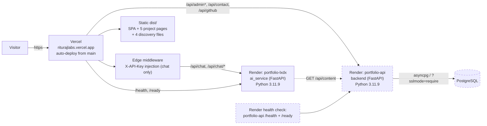
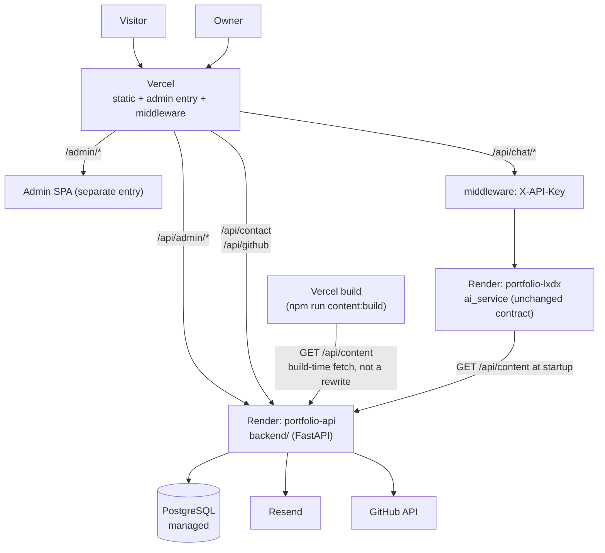

# Deployment Guide

**Document Status:** Active
**Document Type:** Operations Runbook
**Version:** 2.0 — rewritten from the verified codebase
**Last Verified Against Code:** commit `a6895e5` (`main`)

---

## Reading Convention

| Label | Meaning |
|---|---|
| **CURRENT** | Deployed today. Verified against config files. |
| **TARGET** | Planned. Not deployed. |
| **MIGRATION** | The ordered path from one to the other. |

---

# 1. CURRENT Topology

> **CURRENT vs TARGET.** The Vercel frontend and the `portfolio-lxdx` AI service
> are deployed today (**CURRENT**). The `portfolio-api` backend and its
> PostgreSQL database are the target of §6 and are **not yet deployed**
> (**TARGET**); they are drawn dashed below. Nothing in this section implies a
> production step has already run.



| Component | Platform | Service | Source |
|---|---|---|---|
| Frontend | Vercel | static build of `dist/` | `main` (auto-deploy) |
| AI service | Render | `portfolio-lxdx` | `ai_service/` (`Procfile`; Python 3.11.9 — `runtime.txt` is not read by Render, see §6.5) |
| Backend API | Render | `portfolio-api` (**TARGET**) | `backend/` (`Procfile`; Python pinned via `PYTHON_VERSION` / `.python-version`, see §6.5) |
| Database | Managed PostgreSQL | instance, Render or external (**TARGET**) | `DATABASE_URL`, supplied to `portfolio-api` only (`sync: false`; §6.5) |
| Email | Resend | transactional | `RESEND_API_KEY` |
| LLM | Groq → Gemini fallback | inference | `GROQ_API_KEY`, `GEMINI_API_KEY` |
| Vector store | ChromaDB (in-process, ephemeral) | embeddings only | indexed from `GET /api/content` (or `knowledge_base.json` in `KNOWLEDGE_SOURCE=file` rollback) |
| Analytics | Vercel Speed Insights | — | `@vercel/speed-insights` |

## 1.1 The build pipeline — 5 stages

`package.json` `build`:

```bash
vite build                                   # 1. client bundle (public + /admin)  -> dist/
node scripts/assert-admin-bundle.mjs         # 2. public/admin bundle isolation     -> fails on leakage
vite build --config vite.prerender.config.js # 3. SSR bundle                        -> .prerender/entry.mjs
node scripts/generate-project-pages.mjs      # 4. 5 project HTML                    -> dist/projects/<slug>/index.html
node scripts/generate-seo-discovery.mjs      # 5. discovery files                   -> sitemap.xml, sitemap-images.xml, robots.txt, llms.txt
```

**Output of a successful build: 8 HTML documents** (`index.html` + the
`admin.html` entry + 5 project pages) and 4 discovery files.

**Stage 2 is the Phase 5 isolation guard.** It walks `dist/.vite/manifest.json`,
reads every chunk the public entry loads, and fails the build if any admin
marker or `react-router-dom` code is present — the ADR-010 acceptance is
therefore always asserted, not just checked once.

**Stage 4 and 5 are validators as much as generators.** They fail the build on
malformed project data, missing images, wrong image dimensions, missing SEO
fields, or inconsistent `llms.txt` output. This is the single most valuable
property of the current setup and the migration must not weaken it.

## 1.2 Routing — `vercel.json` rewrites

| Public path | → Render | Note |
|---|---|---|
| `/admin` | → `/admin.html` | Same-site SPA fallback, no backend hop |
| `/admin/:path*` | → `/admin.html` | SPA fallback (client-side routes resolve at `/admin`) |
| `/api/admin` | `https://portfolio-api-j7xc.onrender.com/api/admin` | Same-origin admin API (map 1:1) |
| `/api/admin/:path*` | `.../api/admin/:path*` | |
| `/api/resume` | `https://portfolio-api-j7xc.onrender.com/api/resume` | Public same-origin resume PDF; the backend streams it from the **private** `uploads` bucket. Exact path, no `:path*` |
| `/api/chat` | `https://portfolio-lxdx.onrender.com/chat` | Service registers chat at **root** |
| `/api/chat/:path*` | `.../chat/:path*` | |
| `/api/contact` | `https://portfolio-api-j7xc.onrender.com/api/contact` | **backend** since Phase 8; `backend/app/routes/contact.py` uses `prefix="/api"` |
| `/api/github` | `https://portfolio-api-j7xc.onrender.com/api/github` | **backend** since Phase 8; `backend/app/routes/github.py` uses `prefix="/api"` |
| `/health` | `https://portfolio-lxdx.onrender.com/health` | |
| `/ready` | `https://portfolio-lxdx.onrender.com/ready` | |

**The asymmetry is real and intentional:** chat is registered at `/chat`, so
`/api/chat` must be rewritten to `/chat`; github/contact are registered under
`/api`, so they map 1:1, and both now land on the **backend** service
(`portfolio-api`) alongside `/api/admin/*`. The browser only ever talks to its
own origin: `/admin/*` pages and `/api/admin/*` calls are both same-origin (the
admin cookie is HttpOnly + `SameSite=Strict`; `ADMIN_API_BASE` is `/api/admin`,
so no cross-origin CORS is involved). Changing any side of a mapping without the
other is a 404.

**`/api/resume` is a public, backend-owned rewrite.** It is the target of the
site's "Download resume" link: `portfolio-api` serves the PDF at
`GET /api/resume` (streamed from the **private** `uploads` bucket) and the
browser reaches it same-origin. The rule is an **exact path** with no `:path*`
guard, so it matches only `/api/resume`. Vercel evaluates rewrites in the order
they are listed and the **first match wins**; `/api/resume` is disjoint from the
`/api/admin`, `/api/chat` and `/api/contact` prefixes, so no other rule competes
for it. The destination here matches `vercel.json` verbatim
(`https://portfolio-api-j7xc.onrender.com/api/resume`), and changing either side
without the other is a 404.

**`/api/content` is deliberately *not* a rewrite.** The browser never calls it —
the frontend bakes the content into the build (stage 0, `npm run content:build`)
by fetching `CONTENT_API_URL` directly from the `portfolio-api` origin, and the
AI service fetches the same URL at startup. Both are server-to-server calls to
`https://portfolio-api-j7xc.onrender.com/api/content`, not paths on the Vercel
domain. `/health` and `/ready` on the Vercel domain likewise rewrite to the AI
service (they are that service's probes); the backend's own `/health` and
`/ready` live at `https://portfolio-api-j7xc.onrender.com`, which is the path Render's
health check polls. There is no `/api/projects` route anywhere — it was dropped
(`API.md` §5.1.1). The `/api/admin` exact-path rule (without `:path*`) is a
same-origin passthrough that matches no backend route; the admin SPA only ever
calls subpaths under `/api/admin/`.

**SSE note.** `/api/chat/stream` matches `/api/chat/:path*`. Streaming works
through Vercel's edge because the response is `text/event-stream` and no
buffering is applied to it. Do not add a proxy that buffers.

## 1.3 Security headers — `vercel.json`

Applied to `/(.*)`:

| Header | Value |
|---|---|
| `X-Content-Type-Options` | `nosniff` |
| `X-Frame-Options` | `SAMEORIGIN` |
| `Referrer-Policy` | `strict-origin-when-cross-origin` |
| `Strict-Transport-Security` | `max-age=63072000; includeSubDomains; preload` |
| `Permissions-Policy` | `camera=(), microphone=(), geolocation=(), payment=(), usb=(), interest-cohort=()` |
| `Cross-Origin-Opener-Policy` | `same-origin` |
| `Cross-Origin-Resource-Policy` | `same-site` |

**Cache-Control** — `/assets/*` and `/images/*`:
`public, max-age=31536000, immutable`. Favicons, `site.webmanifest`,
`sitemap.xml`, `robots.txt`, `llms.txt`, `humans.txt`: `max-age=86400` or
`max-age=3600`.

**Admin SPA is never cached and never indexed:**
`/admin.html`, `/admin` and `/admin/(.*)` all return `Cache-Control: no-store`
and `X-Robots-Tag: noindex` (the admin `<head>` also carries those as HTML
meta). The session cookie must not land in a shared browser cache, and the
dashboard must not appear in search results or link previews.

**Verification:** `https://riturajlabs.vercel.app/security.txt` returns `200`
because `public/security.txt` is a static file, not a Vercel feature.

## 1.4 Environment variables — CURRENT

| Variable | Platform | Secret | Purpose |
|---|---|---|---|
| `BACKEND_API_KEY` | Vercel (Production + Preview) | yes | Injected as `X-API-Key` by edge middleware for `/api/chat/*` |
| `CONTENT_API_URL` | Vercel (**build-time only**) | no | **Required for the production build.** `https://portfolio-api-j7xc.onrender.com/api/content`; `scripts/build-content.mjs` fetches it and the build fails closed if it is unreachable or unseeded. Never read by the browser — the frontend runtime needs no variables |
| `CONTENT_API_TIMEOUT`, `CONTENT_API_ATTEMPTS` | Vercel (**build-time only**) | no | Optional. Per-attempt timeout (default `10` s) and bounded attempt budget (default `4`) for the build fetch. The backend cold-starts after idling (Render free tier); the build retries transient timeout/network/5xx failures so a cold start does not fail the build |
| `AI_SERVICE_KEY` | Render | yes | **Must equal** `BACKEND_API_KEY`; verifies `/api/chat/*` only |
| `GITHUB_USERNAME` | Render — `portfolio-api` (backend) since Phase 8 | no | Proxy target |
| `GITHUB_TOKEN` | Render — `portfolio-api` (backend) since Phase 8 | yes | Raises the GitHub API limit to 5000/h |
| `RESEND_API_KEY` | Render — `portfolio-api` (backend) since Phase 8 | yes | Contact delivery |
| `CONTACT_FROM_EMAIL` | Render — `portfolio-api` (backend) since Phase 8 | no | Verified Resend sender |
| `CONTACT_TO_EMAIL` | Render — `portfolio-api` (backend) since Phase 8 | no | Contact recipient |
| `AWS_ACCESS_KEY_ID` | Render — `portfolio-api` (backend) | yes | Object storage (Neon Object Storage) credential for `POST /api/admin/uploads` |
| `AWS_SECRET_ACCESS_KEY` | Render — `portfolio-api` (backend) | yes | Object storage secret |
| `AWS_ENDPOINT_URL_S3` | Render — `portfolio-api` (backend) | no | Object storage endpoint (`neon deploy` value); **branch-scoped** |
| `AWS_REGION` | Render — `portfolio-api` (backend) | no | Object storage region |
| `S3_BUCKET` | Render — `portfolio-api` (backend) | no | `public_read` bucket name (default `media`) |
| `CONTACT_RATE_LIMIT`, `CONTACT_RATE_WINDOW_SECONDS` | Render — `portfolio-api` (backend) since Phase 8 | no | Contact rate limit (defaults 5 / 60 s) |
| `GROQ_API_KEY` | Render | yes | Primary LLM |
| `GEMINI_API_KEY` | Render | yes | Fallback LLM |
| `CHROMA_DB_PATH` | Render | no | ChromaDB persistence path (default `./chroma_db`) |
| `ENV` | Render | no | **Must stay unset or `production`.** `ENV=development` disables chat auth (`SECURITY.md` §2.6) |
| `ALLOWED_ORIGINS` | Render | no | CORS allow-list |
| `GROQ_MODEL`, `CHAT_*`, `LLM_CACHE_*`, `EMBEDDING_CACHE_*`, `CHAT_TOP_K`, `CHAT_SCORE_THRESHOLD` | Render | no | Tunables — see `ai_service/config/settings.py` |

**Contact delivery (`RESEND_API_KEY`, `CONTACT_FROM_EMAIL`)** — Resend's sandbox
sender `onboarding@resend.dev` may only deliver to the address that owns the
Resend account. While that sender is configured, `CONTACT_TO_EMAIL` **must** be
the account owner's own address; any other recipient is rejected with
`403 validation_error` and `POST /api/contact` answers `502`. To deliver to a
different inbox, verify a domain at resend.com/domains and set
`CONTACT_FROM_EMAIL` to an address on that domain.

**No `VITE_*` variable should be set in production.** Every one of them is
inlined into the public bundle at build time — see `SECURITY.md` §3.1.

## 1.5 Local development — CURRENT

```bash
# frontend
npm install
npm run dev                  # http://localhost:5173

# ai_service (separate terminal)
cd ai_service
python -m venv .venv && source .venv/bin/activate
pip install -r requirements.txt
uvicorn app:app --reload --port 8000
```

**Vite dev proxies (Phase 8):** `vite.config.js` forwards `/api/admin`, `/api/contact` and `/api/github` to `http://localhost:8001` — those requests are genuinely same-origin through the proxy, mirroring production. Chat is the one service with **no** dev proxy: the browser calls `${VITE_BACKEND_URL}/api/...` directly, so `VITE_BACKEND_URL=http://localhost:8000` must be set in `.env` (copy `.env.example`) and the `ai_service` must run on `:8000`. The backend runs on port `8001` (`uvicorn app.main:app --reload --port 8001` from `backend/`).

`ai_service` needs its own `.env` with real keys; contact/GitHub are served locally by the backend, which needs `RESEND_API_KEY` (optional in dev — absent ⇒ `502` configuration body, row still stored) and `GITHUB_USERNAME`.

---

# 2. TARGET Topology



| Component | Platform | Change |
|---|---|---|
| Frontend | Vercel | **No change.** Same auto-deploy from `main`. |
| `backend/` | Render | **New service**, `portfolio-api`, own `Procfile`; Python pinned via `PYTHON_VERSION` (§6.5) |
| `ai_service` | Render | **No contract change.** Knowledge source switches to the API. |
| Database | Managed PostgreSQL | **New.** |
| Vercel rewrites | `vercel.json` | 2 destinations change, 2 added for `/admin` |
| Edge middleware | `middleware.js` | No change; `/api/contact` now resolves to `backend/` |

**Three services, two platforms, one database.** No Kubernetes, no service mesh,
no container registry beyond what each platform provides, no CI/CD tool beyond
GitHub Actions.

---

# 3. TARGET Environment Variables

## 3.1 `backend/` (Render)

**Status** — *shipped* rows exist in the code today; *planned* rows are named here
so the deployment can be configured ahead of the phase that reads them. A planned
variable set on the platform is harmless; a shipped one left unset is not.

| Variable | Secret | Required | Phase | Purpose |
|---|---|---|---|---|
| `DATABASE_URL` | yes | yes | 2 · shipped | PostgreSQL connection string. Production requires `?sslmode=require` |
| `ENVIRONMENT` | no | yes | 2 · shipped | `development` \| `staging` \| `production` |
| `ALLOWED_ORIGINS` | no | yes | 3 · shipped | Comma-separated exact origins. **`*` is refused at startup in `staging` and `production`** (`SECURITY.md` §2.3), so this is a hard requirement, not a convention |
| `TRUSTED_PROXY_HEADER` | no | yes | 3 · shipped | Header the trusted edge overwrites with the real client IP. **Set to `cf-connecting-ip` on Render**, or every caller shares the load balancer's bucket and all per-IP limits (`/api/content`, contact, admin login) collapse into one global window. Only `cf-connecting-ip` is accepted; `x-forwarded-for` is refused at startup (`SECURITY.md` §3.6a) |
| `CONTENT_RATE_LIMIT` | no | no | 3 · shipped | Requests per window per IP on `/api/content`. Default `300` |
| `CONTENT_RATE_WINDOW_SECONDS` | no | no | 3 · shipped | Default `60` |
| `ADMIN_SESSION_IDLE_SECONDS` | no | no | 4 · shipped | Idle timeout, also the cookie `Max-Age`. Default `43200` (12 h) |
| `ADMIN_SESSION_ABSOLUTE_SECONDS` | no | no | 4 · shipped | Absolute lifetime. Default `604800` (7 d). Must be ≥ the idle value or the process refuses to start |
| `ADMIN_LOGIN_IP_LIMIT` | no | no | 4 · shipped | Default `10` |
| `ADMIN_LOGIN_IP_WINDOW_SECONDS` | no | no | 4 · shipped | Default `900` |
| `ADMIN_LOGIN_EMAIL_FAILURE_LIMIT` | no | no | 4 · shipped | Default `5` |
| `ADMIN_LOGIN_EMAIL_WINDOW_SECONDS` | no | no | 4 · shipped | Default `900` |
| `CONTACT_TO_EMAIL` | no | yes | 8 · shipped | Contact inbox destination (default `riturajlabs@outlook.com`) |
| `CONTACT_FROM_EMAIL` | no | no | 8 · shipped | Verified Resend sender (default `onboarding@resend.dev`) |
| `RESEND_API_KEY` | yes | yes | 8 · shipped | Contact delivery |
| `GITHUB_USERNAME` | no | yes | 8 · shipped | GitHub proxy target |
| `GITHUB_TOKEN` | yes | no | 8 · shipped | Raises the API limit |
| `CONTACT_RATE_LIMIT` | no | no | 8 · shipped | Contact requests per window per IP. Default `5` |
| `CONTACT_RATE_WINDOW_SECONDS` | no | no | 8 · shipped | Default `60` |
| `AWS_ACCESS_KEY_ID` | yes | yes | Neon · shipped | Object storage credential for `POST /api/admin/uploads` |
| `AWS_SECRET_ACCESS_KEY` | yes | yes | Neon · shipped | Object storage secret |
| `AWS_ENDPOINT_URL_S3` | no | yes | Neon · shipped | `neon deploy` endpoint; **branch-scoped**, so it changes with the branch |
| `AWS_REGION` | no | yes | Neon · shipped | Object storage region |
| `S3_BUCKET` | no | no | Neon · shipped | Bucket name (default `media`). Must be `public_read` |
| `S3_IMAGE_MAX_BYTES` | no | no | Neon · shipped | Max upload size. Default `5000000` |
| `S3_RESUME_BUCKET` | no | no | Neon · shipped | Private bucket for the admin-uploaded resume. Default `uploads`; **must stay private** (never `public_read`) and is distinct from the public `media` bucket. Read only through `GET /api/resume` |
| `S3_RESUME_MAX_BYTES` | no | no | Neon · shipped | Max resume upload size in bytes. Default `10000000` (10 MB) |
| `LOG_LEVEL` | no | no | 2 · shipped | Default `INFO` |
| `DEPLOY_HOOK_URL` | yes | no | 4 · shipped | Vercel Deploy Hook URL for `POST /api/admin/publish`. Capability token; unset disables rebuild (`configured: false`) |
| `DEPLOY_HOOK_TIMEOUT_SECONDS` | no | no | 4 · shipped | Default `10` |
| `AI_SERVICE_URL` | no | no | 9 · shipped | AI service bare origin, e.g. `https://portfolio-lxdx.onrender.com`. Unset (or without a token) disables re-ingest |
| `AI_SERVICE_ADMIN_TOKEN` | yes | no | 9 · shipped | Must equal the AI service `ADMIN_TOKEN` (§3.5). Capability token |
| `AI_SERVICE_TIMEOUT_SECONDS` | no | no | 9 · shipped | Default `30` |
| `ADMIN_READ_RATE_LIMIT` | no | no | 4 · shipped | Authenticated `GET /api/admin/*` per user. Default `600` |
| `ADMIN_READ_RATE_WINDOW_SECONDS` | no | no | 4 · shipped | Default `60` |
| `ADMIN_BOOTSTRAP_TOKEN` | yes | no | bootstrap · shipped | One-time capability token (≥32 chars). While set, enables `POST /api/admin/bootstrap`, which creates the first administrator and loads the initial content atomically (§6.6). Unset or empty disables the endpoint. **Remove after a successful bootstrap** |
| `PYTHON_VERSION` | no | no | 2 · shipped | `3.11.9`; Render's Python pin. Render ignores `runtime.txt`, so this (with `backend/.python-version`) is authoritative |

**`IP_HASH_SALT` is withdrawn.** An earlier draft of this table listed it for
the `contact_message` row's IP hash. Phase 8 shipped without it, deliberately:
`contact.source_ip_hash` reuses `client_ip_hash` from `app/services/auth.py`,
an HMAC-SHA-256 over the raw IP with a **process-local, regenerated-daily key**.
A configured salt would offer the same property (you cannot brute-force the raw
IP without the daily key) while adding a rotation concern, and auth.py already
made the process-local choice — documented in `SECURITY.md` §2.1. Setting
`IP_HASH_SALT` on the platform today is harmless because the process never reads
it; it is kept out of the table so no operator has to generate a value that does
nothing.

**`ADMIN_SESSION_SECRET` is withdrawn.** An earlier draft of this table listed it
as planned for Phase 4. Phase 4 shipped without it, and deliberately:

* **No signing secret.** The session cookie carries a random 256-bit token and the
  server stores only its SHA-256 hash. Nothing is signed, so there is nothing to
  sign with, and the CSRF value is derived from the session token itself rather
  than from a configured key. Adding a secret would create a rotation concern
  (`SECURITY.md` §4.2) without protecting anything the hash does not already.

`ADMIN_SESSION_SECRET` is not read by anything; setting it is harmless but
pointless.

**Two ways to create the first administrator, and only two.** Both exist in the
code; pick by host capability, not preference:

* **`ADMIN_BOOTSTRAP_TOKEN` — the free-tier production path.** The shipped
  bootstrap endpoint (`POST /api/admin/bootstrap`,
  `backend/app/routes/admin_bootstrap.py`) creates the first `admin_user` **and**
  loads the initial CMS content in one atomic transaction, over HTTPS, with no
  Shell and no one-off job. Its client half is `npm run admin:bootstrap`
  (`scripts/bootstrap-content.mjs`). See §6.6. The running service reads the token
  only to compare it; **unset it after a successful bootstrap** and the endpoint
  answers `404`.
* **`python -m db.admin` — local development and paid Shell alike.** The CLI
  (wrapped as `npm run admin:setup` / `npm run admin:reset`) reads
  `ADMIN_EMAIL` and `ADMIN_PASSWORD` **once** to create or replace the single
  `admin_user` row. Those two variables are read only by that command, never by
  the running service, so they are not part of the service environment — supply
  them to a one-off shell/job. `MIGRATION.md` §Phase 4 and
  `ENVIRONMENT_VARIABLES.md` describe the same split. On a Free Render plan the
  CLI cannot run (Render's free instances have no Shell and cannot run one-off
  jobs), so the bootstrap endpoint is the only production option there.

**`RATE_LIMIT_ENABLED` is withdrawn.** An earlier draft of this table listed a
boolean to switch rate limiting off. Phase 3 ships no such switch: a public read
endpoint that can be silently unprotected by one environment variable is not worth
the convenience, and `CONTENT_RATE_LIMIT` can already be raised. `/health` and
`/ready` are exempt by design and need no switch either (`SECURITY.md` §3.6a).

## 3.2 `ai_service` (Render) — additions

| Variable | Secret | Purpose |
|---|---|---|
| `CONTENT_API_URL` | no | `https://portfolio-api-j7xc.onrender.com/api/content` |
| `CONTENT_API_TIMEOUT` | no | Default `10` seconds |
| `KNOWLEDGE_SOURCE` | no | `api` (default after Phase 9) \| `file` (rollback) |
| `TRUSTED_CLIENT_IP_HEADER` | no | Header Vercel's edge stamps with the signed real client IP. **Set to `x-vercel-client-ip` on Render**; leave unset locally. Only that name is accepted (`SECURITY.md` §3.6b). Unset = every caller shares the Render load balancer's bucket and the chat limit collapses into one global window |
| `CLIENT_IP_SIGNING_SECRET` | yes | Optional. Defaults to `AI_SERVICE_KEY`, which is the value the edge signs with, so no extra secret is needed unless you want to rotate the two independently |

Existing variables are unchanged.

**Why a signed header rather than `cf-connecting-ip`.** Unlike `backend/`, the AI
service is *not* reached directly through Cloudflare: `/api/chat/*` is rewritten
by Vercel's edge (`middleware.js`), so at Render the Cloudflare client is
Vercel's egress, not the browser. `CF-Connecting-IP` therefore does not carry the
end-user address here. The edge instead reads Vercel's authoritative `x-real-ip`,
overwrites both client-IP headers, and HMAC-signs the value with the shared
secret; the service trusts it only when the signature verifies. See `SECURITY.md`
§3.6b.

## 3.3 Vercel

| Variable | Change |
|---|---|
| `BACKEND_API_KEY` | **Unchanged.** Protects `/api/chat/*`; no longer sent to `/api/contact` (backend never verified it) |
| `AI_SERVICE_KEY` | Unchanged |
| `CONTENT_API_URL` | **Required (build-time, not a secret).** Set to `https://portfolio-api-j7xc.onrender.com/api/content` on the Vercel project. The build fetches it and fails closed if the endpoint is unavailable; the variable is never read by the frontend runtime or shipped to the browser, so it is neither a runtime variable nor a secret. See §1.4 and §6.2 step 8. |
| `CONTENT_API_TIMEOUT`, `CONTENT_API_ATTEMPTS` | Optional build-time tuning (not secrets). Defaults `10` s per attempt and `4` attempts. `src/lib/content.js` retries a transient timeout/network/5xx so a Render free-tier cold start (measured ~33 s) does not fail the build; a deterministic 4xx or invalid/contract-breaking payload still fails closed on the first response. |
| `VITE_*` | **Must remain unset in production.** See `SECURITY.md` §3.1 |

No Vercel variable holds a secret: the frontend runtime requires none, and
`CONTENT_API_URL` is a non-secret build input (the public backend content URL).
`BACKEND_API_KEY` stays server-side (edge middleware / Vercel project settings)
and is never a client variable.

## 3.4 Secret rotation procedure

1. Generate: `openssl rand -base64 48`
2. Set the new value in **both** Vercel and Render for the paired secret.
3. Redeploy Render, then Vercel. There is a short window where old and new keys
   coexist; chat may fail during it. Rotate during low traffic.
4. There is no `ADMIN_SESSION_SECRET` to rotate — sessions are not signed, so no
   secret governs them (withdrawn above). To force every admin out, revoke them in
   the database: `UPDATE admin_session SET revoked_at = now() WHERE revoked_at IS
   NULL;`. Every live cookie stops working on its next request.
5. Never commit a secret. Never print one in a log. `SECURITY.md` §8.

## 3.5 Matching token pairs (must be identical across platforms)

Three values are shared capability secrets. Setting one side without the other
fails closed: the backend reports the feature `not_configured`, and the AI service
rejects the request (`401`) or hides the route (`404`).

| Purpose | Value A | Value B | Verified by |
|---|---|---|---|
| Chat `/api/chat/*` (`X-API-Key`) | Vercel `BACKEND_API_KEY` | AI service `AI_SERVICE_KEY` | `ai_service` on `/chat*` |
| Publish → AI re-ingest (`X-Admin-Token`) | backend `AI_SERVICE_ADMIN_TOKEN` | AI service `ADMIN_TOKEN` | `ai_service` on `POST /admin/reingest` |
| Edge client-IP signature (HMAC-SHA-256) | Vercel `BACKEND_API_KEY` (signing key) | AI service `CLIENT_IP_SIGNING_SECRET` | `ai_service` trusts `x-vercel-client-ip` only when the signature matches |

`CLIENT_IP_SIGNING_SECRET` defaults to `AI_SERVICE_KEY` when unset, so with the
defaults the first and third rows share one value. Rotate each pair in both
platforms together (§3.4).

---

# 4. Local Development — TARGET

```bash
# 1. database
docker run -d --name portfolio-db \
  -e POSTGRES_PASSWORD=postgres -e POSTGRES_DB=portfolio \
  -p 5432:5432 postgres:16-alpine

# 2. backend
cd backend
python -m venv .venv && source .venv/bin/activate
pip install -e ".[dev]"
cp .env.example .env
alembic upgrade head
python -m db.seed
uvicorn app.main:app --reload --port 8001

# 3. frontend
npm install
npm run dev                       # http://localhost:5173
```

| Service | URL |
|---|---|
| Frontend | `http://localhost:5173` |
| `backend/` | `http://localhost:8001` |
| `ai_service` | `http://localhost:8000` |
| Admin | `http://localhost:5173/admin` |

**Expected in dev, not in production**

* Rate limiting has no off switch (§3.1); locally, raising `CONTENT_RATE_LIMIT`
  is the escape hatch.
* Chat degrades to the committed knowledge-base snapshot when `backend/` is down.
* The frontend falls back to the committed snapshot and logs one warning.
* **The build does not fall back.** `npm run build` fails if the API is
  unreachable (ADR-005) — that is intentional in every environment.

---

# 5. Build and Release — CURRENT

| Trigger | Action |
|---|---|
| Push to `main` | Vercel auto-deploys. `ai_service` **does not** auto-deploy |
| `ai_service` change | Manual: Render dashboard → Manual deploy, or a Render GitHub hook |
| Rollback (frontend) | Vercel → Deployments → promote a previous build. Instant |
| Rollback (backend) | Render → Rollback to previous deploy |

**CI (Phase 10).** `.github/workflows/ci.yml` runs lint → unit → extract seed
snapshot → api → ai_service → build → migration-validation → e2e on every PR and
push to `main`. The seed snapshot must be extracted before the tests that read
it (`.cache/content-snapshot.json` is git-ignored, so a clean checkout has none):
the backend `test_seed.py` and the `ai_service` `canonical_payload` fixture both
depend on it, so the extract step precedes the api and ai_service steps. The
workflow has been **locally validated with faithful simulations** but has not yet
run on GitHub Actions; it becomes a hard gate on the first push.

**Manual verification before any production deploy**

```bash
npm ci
npm run lint
npm test
npm run build
ls dist/projects/*/index.html | wc -l    # must print 5
curl -sI https://riturajlabs.vercel.app/ | head -1
curl -s  https://riturajlabs.vercel.app/llms.txt
```

---

# 6. MIGRATION — Deployment Runbook

> **This section is the ONE authoritative deployment sequence.**
> `MIGRATION.md` §3 and Phase 11 reference this section. They do not restate it.
> If a step appears anywhere else with different ordering or different content,
> this section is correct and the other copy is stale.

**Rule: one step at a time, each verified before the next.** Steps 1–10 have
**zero user-facing impact**. The public site is not touched until step 11.

## 6.1 The canonical sequence

```text
 1. Provision PostgreSQL
 2. Deploy backend service (migrations run in the build)
 3. Verify backend liveness (/health)
 4. Verify readiness (/ready)
 5. Bootstrap: create the admin + seed content (one-time, over HTTPS)
 6. Verify seed/content parity
 7. Disable bootstrap and redeploy (remove ADMIN_BOOTSTRAP_TOKEN)
 8. Configure frontend environment variables
 9. Run frontend production build
10. Verify prerender output
11. Deploy frontend to Vercel
12. Smoke test production
13. Monitor logs
```

**Migrations now run inside the backend build** (`buildCommand:
pip install . && python -m alembic upgrade head`, §6.5). A free Render web service
has no Shell and no one-off jobs, and `preDeployCommand` is paid-only, so the
build is the only pre-start hook the free plan offers. The command is idempotent —
the first deploy creates the schema, every later deploy is a no-op — and the
deploy **fails closed** before the service starts if the schema cannot be brought
to head.

The backend (steps 2–4) is deployed **before** bootstrap (step 5) and parity
verification (step 6) on purpose: both the bootstrap endpoint and `seed:verify`
require the running `portfolio-api` service, and `POST /api/admin/bootstrap`
returns `503` until migrations are applied. Bootstrap and verification must
complete **before** the frontend build (step 9), which fails closed on an empty
content API.

## 6.2 Step detail

| # | Step | Command / action | Verification gate | Blast radius |
|---|---|---|---|---|
| 1 | Provision PostgreSQL | Create a managed instance and copy its connection string (`?sslmode=require` for a render.com/external URL). Store it as `DATABASE_URL` on the `portfolio-api` service. Prefer a non-expiring free tier (Neon) — Render free Postgres **expires 30 days after creation** (§11) | `psql "$DATABASE_URL" -c 'select 1'` connects | none |
| 2 | Deploy backend service | Set `ADMIN_BOOTSTRAP_TOKEN` (≥32 chars, one-time) plus the other `sync: false` secrets, then create/sync the Blueprint. The build runs `alembic upgrade head` against `DATABASE_URL` | Build log shows `alembic upgrade head` succeeding; the service starts | none |
| 3 | Verify backend liveness | `GET https://portfolio-api-j7xc.onrender.com/health` | **`200`** — process alive, no dependency check (allow ~1 min on the first cold start) | none |
| 4 | Verify readiness endpoint | `GET https://portfolio-api-j7xc.onrender.com/ready` | **`200`** — database reachable **and** migrations applied. `503` means stop. | none |
| 5 | Bootstrap admin + content | On a machine with Node: `ADMIN_EMAIL=… ADMIN_PASSWORD=… ADMIN_BOOTSTRAP_TOKEN=… CONTENT_API_URL=https://portfolio-api-j7xc.onrender.com npm run admin:bootstrap` (§6.6) | **Exits `0`** and reports the summary (5 projects, 16 skills, …); a repeat run exits `0` with "already bootstrapped (409)" | none |
| 6 | Verify seed/content parity | Read-only, from a machine with Node: `CONTENT_API_URL=https://portfolio-api-j7xc.onrender.com npm run seed:verify` | **Exits 0.** Field-by-field diff of the live API payload against the extracted snapshot. Any difference fails. | none |
| 7 | Disable bootstrap | Remove `ADMIN_BOOTSTRAP_TOKEN` from the `portfolio-api` service and redeploy (§6.6) | `POST /api/admin/bootstrap` now returns **`404`**; `/health` and `/ready` still `200` | none |
| 8 | Configure frontend environment variables | Set `CONTENT_API_URL` on the Vercel project (**build-time**). Confirm no `VITE_*` secret is set. | Variable present in the Vercel environment; build log shows the URL resolved | none |
| 9 | Run frontend production build | `npm run build` | **Exits 0.** The build calls `GET /api/content` and **fails** if the API is unreachable or returns zero projects | none |
| 10 | Verify prerender output | `ls dist/projects/*/index.html \| wc -l`; inspect discovery files | **Exactly 5** project pages; `sitemap.xml`, `sitemap-images.xml`, `robots.txt`, `llms.txt` all present and byte-comparable to the pre-migration capture | none |
| 11 | Deploy frontend to Vercel | Promote to production (preview first if desired) | Deployment marked ready | **production** |
| 12 | Smoke test production | `TESTING.md` §11 checklist | All 7 URLs 200; contact form submits; GitHub stats render; chat streams; resume downloads; 4 discovery files 200 | — |
| 13 | Monitor logs | Watch Render + Vercel logs for 24 h | No 5xx; `GET /api/content` p95 < 100 ms; no build failures | — |

> **Free-tier execution model.** Every database step runs over the network, not in
> a Render Shell: migrations execute in the build (step 2) and the first
> administrator + content are created through `POST /api/admin/bootstrap`
> (step 5). That is why no step needs a Shell or a one-off job. Never point a
> workstation `DATABASE_URL` at production.

### Admin provisioning + first content (step 5)

The running backend never creates an administrator on its own, and a free Render
service cannot run the `python -m db.admin` CLI. Both the first administrator and
the initial CMS content are therefore created by the one-time
`POST /api/admin/bootstrap` endpoint, driven by `npm run admin:bootstrap`. The full
procedure — generating the token, setting it on Render, running the client, and
disabling the endpoint again — is §6.6.

The local CLI (`python -m db.admin`, `npm run admin:setup`) still exists for
development against a local database, but it is **not** part of the production
sequence.

### Seed verification (step 6) is read-only

`scripts/compare-content.mjs` calls `GET ${CONTENT_API_URL}/api/content` and diffs
the response field-by-field against the snapshot, so it requires a **running
backend** and a machine with **Node** — it is not run from a Render Shell. From a
local machine, with the snapshot already generated:

```bash
CONTENT_API_URL=https://portfolio-api-j7xc.onrender.com npm run seed:verify
```

This is a `GET` only: it holds no database credentials and writes nothing. A
missing `CONTENT_API_URL` defaults to `http://127.0.0.1:8001` (the local backend),
which is why the variable must be set explicitly against the deployed service.

## 6.3 Hard ordering constraints

These orderings are not preferences. Violating them fails loudly or, worse,
silently.

| Constraint | Why |
|---|---|
| **1 before 2** | Migrations run inside the backend build and need a reachable database. Provisioning first lets the very first build succeed instead of failing closed. |
| **2 before 3 and 4** | `/ready` returns `503` until migrations are applied. The build applies them, so the service never serves traffic before the schema is at head. |
| **3 and 4 before 5** | `POST /api/admin/bootstrap` returns `503` until the database is reachable and migrated; it also confirms state via the deployed service. |
| **5 before 6** | Parity compares the live `GET /api/content` against the snapshot, which only matches after bootstrap has seeded it. |
| **6 before 7** | Do not remove `ADMIN_BOOTSTRAP_TOKEN` until bootstrap has succeeded; once it is removed the only way back in is a redeploy with the token re-set. |
| **5 and 6 before 9** | The build fetches `GET /api/content`. An unseeded database yields zero projects, which fails the build by design (`ARCHITECTURE.md` ADR-005). A build failure caused by an unverified backend is indistinguishable, in the log, from a real content bug. |
| **3 and 4 before 8** | Environment variables cannot be validated against a service that is not answering. |
| **9 and 10 before 11** | Deploying unverified build output is the only step that can remove indexable URLs. Steps 9–10 are the gate. |

## 6.4 Independent track — ai_service re-point (Phase 9)

**This is NOT part of the canonical sequence above.** It is a separate deployment
on a separate host, with its own trigger, and it may run before, during or after
steps 1–13 without affecting any of them.

| # | Action | Verification | Blast radius |
|---|---|---|---|
| A | Set `CONTENT_API_URL` on the existing `ai_service/` deployment | Env var present | none |
| B | Deploy `ai_service/` | `/ready` `200` after ChromaDB ingestion | chat only |
| C | Ask the chatbot about a seeded project, including Zerodha Clone | Answers correctly | chat only |
| D | Keep `knowledge_base.json` until parity is proven, then remove it | Answers match the live site | chat only |

**Revert for this track:** set `KNOWLEDGE_SOURCE=file` and restart. The retained
`knowledge_base.json` is the fallback (`ARCHITECTURE.md` ADR-006).

**Parity note.** `ai_service/services/parity.py` reports `PARITY: FAIL` *by
design*: the legacy file carries history the API does not own (sections
`education`/`recruiter`/`socials`/`faq`, ~48 non-canonical skill names, project
detail keys). That is expected; `knowledge_base.json` is kept as the rollback
source and is **not** auto-selected on API failure (fail-closed, `MIGRATION.md`
Phase 9).

**Why it is separate.** Chat availability depends on ChromaDB ingestion, which
depends on the content API. Making the portfolio's first deployment depend on a
vector index would promote a non-critical dependency to a critical one
(`ARCHITECTURE.md` ADR-002).

## 6.5 Render backend configuration (`render.yaml`)

The backend's Render settings are declared in the repo-root [`render.yaml`](../render.yaml)
so they are reproducible instead of dashboard-only. The Blueprint manages **only**
`portfolio-api`; the existing `portfolio-lxdx` AI service is not listed and is left
untouched. `DATABASE_URL` and the other secrets use `sync: false`, so Render prompts
for them at creation and no secret value is committed.

| Setting | Value | Why |
|---|---|---|
| Root Directory | `backend` | Monorepo; only the API is built here |
| Runtime | `python` | — |
| Python version | `PYTHON_VERSION=3.11.9` *and* `backend/.python-version` | **Render does not read `runtime.txt`** (the file in `backend/` and `ai_service/` is inert). `pyproject.toml` requires `>=3.11` and Ruff targets `py311`; `3.11.9` is the version the service was developed against |
| Build Command | `pip install . && python -m alembic upgrade head` | `backend/` has no `requirements.txt`; dependencies are in `pyproject.toml` (`packages.find include = ["app*"]`). A free service has no Shell/one-off job and `preDeployCommand` is paid-only, so migrations run here (§6.1) — idempotent, and the deploy fails closed on error |
| Start Command | `uvicorn app.main:app --host 0.0.0.0 --port $PORT` | Matches `backend/Procfile` |
| Health Check Path | `/ready` | §7: do not route traffic to an unreachable or unmigrated database. `/health` remains the dependency-free liveness probe |
| Plan | `free` | Matches the existing AI service |
| Auto-deploy | `off` | Keeps the §6.2 ordering explicit; flip to `commit` to auto-deploy on push |

### Build-time migrations

`preDeployCommand: alembic upgrade head` is the idiomatic hook on a **paid** plan
(it runs after the build, before the service starts, with `DATABASE_URL` present).
The `free` plan does not support it, so migrations run as the second half of the
build command instead (`pip install . && python -m alembic upgrade head`).

Consequences to understand before deploying:

* **It runs on every deploy.** `alembic upgrade head` is idempotent: when the
  database is already at head it is a no-op. No destructive migration is expected,
  but a future migration that rewrites data will run unattended at deploy time.
* **A failure fails the whole deploy closed.** If `DATABASE_URL` is unset/wrong or
  the database is unreachable, the build fails and Render keeps the previous
  deploy. That is safer than starting a service that `/ready` immediately marks
  `503`.
* **`alembic.ini` lives in `backend/`** (the Blueprint's `rootDir`) and its env
  reads `DATABASE_URL` through `app.config`, so no path or variable needs to be
  added to the command. `alembic current` / `alembic check` are no longer part of
  the deploy; run them from your workstation only against a safe, non-production
  `DATABASE_URL`.

Run migrations inside Render (as part of the build) — never point a local or test
`DATABASE_URL` at production; see §6.3.

### Services / platforms not managed by this Blueprint

* `portfolio-lxdx` (AI service) — dashboard-managed; its `CONTENT_API_URL` must be
  `https://portfolio-api-j7xc.onrender.com/api/content` (§6.4).
* The PostgreSQL instance — provision it separately and paste its connection string
  (with `?sslmode=require` for an external URL) into the prompted `DATABASE_URL`. If
  it is a Render Postgres that belongs to this Blueprint, replace that `sync: false`
  entry with `fromDatabase: { name: <db>, property: connectionString }`.
* Vercel — the frontend and its variables (§3.3). `vercel.json` already rewrites to
  `portfolio-api-j7xc.onrender.com`, so the Render service must keep that name.

Render does not read `runtime.txt`, so the committed `backend/runtime.txt` and
`ai_service/runtime.txt` are inert; Python is pinned by `PYTHON_VERSION` /
`.python-version` instead.

## 6.6 One-time bootstrap — first administrator + initial content

A free Render web service has no Shell and no one-off jobs, so the first
administrator and the initial CMS content are created by exactly one HTTPS request
to `POST /api/admin/bootstrap`, sent from your workstation by
`npm run admin:bootstrap` (`scripts/bootstrap-content.mjs`). The endpoint is the
server half (`backend/app/routes/admin_bootstrap.py`); it is **disabled by
default** and enabled only while `ADMIN_BOOTSTRAP_TOKEN` is set on the service.

**Security properties** (asserted by `backend/tests/test_admin_bootstrap.py`):

* **Disabled unless configured.** With no `ADMIN_BOOTSTRAP_TOKEN`, the route
  answers `404` — it does not exist.
* **Constant-time token check** (`hmac.compare_digest`); a wrong or missing token
  is `401`.
* **HTTPS only** in `production`/`staging` (`403` on plain HTTP).
* **Rate limited** to 5 attempts per 15 min per IP (`429`).
* **Permanent lockout:** once any administrator exists the endpoint answers
  `409` — it can never create a second one.
* **Atomic:** the administrator insert and the content seed commit in one
  transaction under a cross-worker `pg_advisory_xact_lock`; any failure rolls
  back, leaving the database clean.
* **Size-bounded** (1 MB) and strictly validated (`422` on a bad snapshot).
* **No secrets in logs or responses** — never the token, password, or its hash.

### Procedure

1. **Generate the token** (≥32 characters; keep it out of shell history):

   ```bash
   openssl rand -hex 32
   ```

2. **Set it on Render.** Add `ADMIN_BOOTSTRAP_TOKEN` to the `portfolio-api`
   service environment (the Blueprint declares it `sync: false`, so Render prompts
   for it at creation) and redeploy so the service sees it.

3. **Generate the snapshot** locally (Node required):

   ```bash
   npm run seed:extract      # -> .cache/content-snapshot.json
   ```

4. **Bootstrap over HTTPS** from your workstation (`.cache/` is not committed; the
   snapshot is public content carrying no credentials):

   ```bash
   ADMIN_EMAIL=owner@example.com \
   ADMIN_PASSWORD='<12+ char secret>' \
   ADMIN_BOOTSTRAP_TOKEN='<the same ≥32-char token>' \
   CONTENT_API_URL=https://portfolio-api-j7xc.onrender.com \
   npm run admin:bootstrap
   ```

   Success prints `[bootstrap] OK — administrator … created; seeded 5 projects …`
   and exits `0`. A second run prints `already bootstrapped (409)` and also exits
   `0` — that is not an error.

5. **Verify parity** (read-only, step 6):

   ```bash
   CONTENT_API_URL=https://portfolio-api-j7xc.onrender.com npm run seed:verify
   ```

6. **Disable bootstrap.** Remove `ADMIN_BOOTSTRAP_TOKEN` from the Render service
   and redeploy. `POST /api/admin/bootstrap` then returns `404`. Confirm with:

   ```bash
   curl -s -o /dev/null -w '%{http_code}\n' \
     -X POST https://portfolio-api-j7xc.onrender.com/api/admin/bootstrap
   # -> 404
   ```

### Client exit codes

`npm run admin:bootstrap` exits `0` (done, or already done), `1` (the server
rejected the request — 401 bad token, 403 non-HTTPS, 404 disabled, 409 already ran,
413 too large, 422 invalid, 429 rate-limited, 503 DB not ready), `2` (a local usage
problem — missing variable, password < 12 chars, missing snapshot) or `3` (the
backend could not be reached). Each non-`2xx` status maps to a plain-language
remediation; the token and password are never printed.

### Why not the CLI

`python -m db.admin` / `python -m db.seed` remain valid **locally** against the dev
database, but they need a Shell (or a one-off job) and a direct `DATABASE_URL`;
neither exists on a free Render service. The bootstrap endpoint is the
free-tier-safe equivalent and the only path this runbook uses in production. A
failed bootstrap wrote nothing, so it is always safe to re-run; the endpoint stays
enabled until you remove the token (step 6).

## 6.7 First resume transition — static PDF → `/api/resume`

This is a **future operator action**, not something the migration performs. The
site is statically generated (`ARCHITECTURE.md` ADR-017): an admin edit changes
the database immediately but only reaches the public pages on the next rebuild.
The resume is the one field where the transition has a first-time step worth
spelling out.

1. **Before the first upload, the public site still serves the bundled PDF.**
   `site_profile.resume` is the tracked in-repo path
   (`/Ritu_Raj_Full_Stack_Developer_Resume.pdf`, asserted by
   `backend/app/services/seed.py`) and the build ships that file. `GET /api/resume`
   answers `404` (`resume_key` is `NULL`) and nothing links to it yet.
2. **A successful admin upload is the save.** From the Profile editor, uploading a
   PDF calls `POST /api/admin/profile/resume`
   (`backend/app/routes/admin_content.py`): the object is written to the private
   `uploads` bucket, the profile's `resume` is repointed to `/api/resume`, and
   `resume_key` records the object key — one audited transaction. The editor shows
   the new value immediately.
3. **The backend change does not rebuild the frontend.** The public pages still
   carry the old, baked-in resume path until a build runs.
4. **The first transition therefore needs one frontend rebuild after the upload.**
   (Later replacements do not — see step 8.)
5. **Prefer the admin "Rebuild site" action when it is wired.** The top-bar button
   calls `POST /api/admin/publish`, which triggers the Vercel Deploy Hook
   (`DEPLOY_HOOK_URL`) and refreshes the AI knowledge base. Use it **only if**
   `DEPLOY_HOOK_URL` is set on the backend and the response reports the rebuild
   step `configured: true` and `ok: true` (§3.1); a `not_configured` or failed
   step means it did not start a build. Otherwise initiate the rebuild manually in
   the Vercel dashboard (Redeploy / Deploy Hook). Never paste the hook URL into a
   browser or log.
6. **What the rebuild does.** `npm run build` fetches `/api/content` from the
   backend, incorporates the updated `resume` path (`/api/resume`) into the
   snapshot, and regenerates the static pages and discovery files.
7. **Verify the transition.** Load the public site, confirm the "Download resume"
   link targets `/api/resume`, and that following it downloads the expected PDF
   (`Content-Type: application/pdf`). `GET /api/resume` returns `200` with the new
   bytes and an ETag equal to the stored object key.
8. **After the transition, no rebuild is needed for future replacements.** The
   public URL is stable (`/api/resume`) and reads the current object from the
   private bucket on every request, so re-uploading a resume changes what the same
   link serves without touching the static build.
9. **AI knowledge side effect.** If publish is used, the same call also POSTs
   `POST /admin/reingest` to the AI service (when `AI_SERVICE_URL` and
   `AI_SERVICE_ADMIN_TOKEN` are set), refreshing the chat assistant's knowledge so
   it does not quote the old resume path. This is part of the existing publish
   workflow; no automatic publishing was added for resume uploads, because doing
   so would consume free-tier build minutes and re-ingest on every upload.

> **Not done here.** As of this migration the first transition has **not** been
> performed — it is pending an operator upload and one rebuild. Automatic
> publishing after every resume upload was deliberately *not* implemented
> (`docs/ARCHITECTURE.md` ADR-017): the stable `/api/resume` URL means a rebuild is
> needed only once, for the change from the static path to `/api/resume`.

---

# 7. Health Checks and Monitoring

| Endpoint | Service | `200` when | Non-`200` when |
|---|---|---|---|
| `/health` | `ai_service` | process alive | never |
| `/ready` | `ai_service` | ChromaDB ingestion finished | `503` during ingestion |
| `/health` | `backend/` (**TARGET**) | process alive, no dependency check | never |
| `/ready` | `backend/` (**TARGET**) | database reachable **and** migrations applied | `503` otherwise |

**Configuration**

| Platform | Check path | Purpose |
|---|---|---|
| Render → `ai_service` | `/health` | restart on crash |
| Render → `backend/` (**TARGET**) | `/ready` | **do not route traffic to an unmigrated database** |

**Migrations run in the backend build** (§6.5), so `/ready` is the gate that proves
the deployed process really has a migrated database behind it; a failed migration
fails the deploy before the process starts. Routing traffic on `/ready` (not
`/health`) is therefore the safe choice for the backend.

**Always probe `/health` for liveness and `/ready` for readiness.** A dependency
check inside the liveness probe causes restart loops when a dependency is slow —
which is exactly what happens while ChromaDB ingests.

**Signals to watch** (`ARCHITECTURE.md` §12)

| Signal | Alert |
|---|---|
| `backend/` 5xx rate > 1% over 15 min | Page |
| `GET /api/content` p95 > 500 ms | Investigate |
| `/ready` non-200 for > 5 min | Page |
| Vercel build failure | Immediate |
| Contact `delivery_status = 'failed'` rising | Investigate Resend |

**Deliberately absent:** no error-tracking SaaS, no APM, no log aggregation, no
synthetic monitoring. Render + Vercel logs, the audit table and these four
endpoints are sufficient for a single-developer portfolio.

---

# 8. Performance Budgets

| Metric | Current | Budget |
|---|---|---|
| JS bundle (gzipped, initial route) | measure in Phase 7 | < 250 KB |
| Public bundle growth from this migration | — | **< 15 KB gzipped** |
| Admin bundle | n/a | not counted — separate entry |
| Largest Contentful Paint (mobile) | baseline before Phase 7 | no regression |
| Cumulative Layout Shift | baseline | no regression |
| `GET /api/content` (cached) | n/a | < 100 ms p95 |
| `GET /api/content` payload | n/a | ≤ 60 KB gzipped |
| Build time | baseline | < +20% |
| `dist/` HTML documents | 6 + 4 files | **exactly the same** |

**Performance is a deployment concern, not just a code concern.** Because the
admin app is a separate entry (ADR-010), the public bundle growth budget is
enforceable — the admin code cannot leak into it.

---

# 9. Disaster Recovery

| Scenario | Impact | Recovery | Data loss |
|---|---|---|---|
| Vercel bad deploy | Site broken | Instant rollback to previous deployment | none |
| `backend/` crash loop | Content falls back; build fails | Render restart; fix forward | none |
| `ai_service` down | Chat widget errors; **site unaffected** | Restart Render | none |
| PostgreSQL unavailable | Content falls back; build fails | Provider failover; restore | unpublished edits |
| Bad seed / wrong content | Wrong text on site | Fix through the admin CMS at `/admin` (no Shell needed — the database is editable there). If the whole database must be rebuilt, re-provision and re-run bootstrap (§6.6) | none — snapshot is the source |
| Leaked `RESEND_API_KEY` | Resend quota abuse | Rotate in Resend, update Render | none |
| Leaked `BACKEND_API_KEY` | LLM abuse cost | Rotate in both places (§3.4) | none |
| Leaked `GITHUB_TOKEN` | Quota abuse | Revoke on GitHub, update Render | none |
| Stolen admin session cookie | Attacker acts as the owner | `UPDATE admin_session SET revoked_at = now() WHERE revoked_at IS NULL;` then have the owner log in again | none |

**The strongest recovery property: `src/data/*.js` remains the committed source
of truth until Phase 12.** If the database is lost entirely, the site is
recoverable by re-seeding from files that have never been deleted. Do not remove
them before then.

---

# 10. Pre-Deployment Checklist

**Every production deploy — current or target**

- [ ] `npm ci` clean
- [ ] `npm run lint` passes
- [ ] `npm run build` passes
- [ ] `ls dist/projects/*/index.html | wc -l` == 5
- [ ] `dist/sitemap.xml`, `sitemap-images.xml`, `robots.txt`, `llms.txt` all present
- [ ] `git status` clean — no uncommitted `src/data/*.js` or `src/config/seo.js`
- [ ] No `.env` file staged
- [ ] No secret in the diff (`git diff --cached | grep -iE 'key|secret|token'` → review every hit)

**Backend deploys (target)**

- [ ] Migrations applied on the target database — the build log shows `alembic upgrade head` succeeding and `/ready` returns `200`
- [ ] `/health` and `/ready` both 200
- [ ] `ALLOWED_ORIGINS` contains the exact production domain — **not `*`**
- [ ] `DATABASE_URL`, `RESEND_API_KEY` present and non-empty
- [ ] `ENVIRONMENT` is `production` — this sets `Secure` on the admin session cookie and enforces HTTPS on bootstrap
- [ ] No `ADMIN_SESSION_SECRET` is set (sessions are database-backed, §3.1)
- [ ] `ADMIN_BOOTSTRAP_TOKEN` (≥32 chars) is set **only** for the bootstrap deploy and removed afterwards (§6.6)
- [ ] The first administrator exists in `admin_user` — created by `npm run admin:bootstrap` (§6.6), never by the running app

**Migration deploys (target)**

- [ ] `seed:verify` reports zero differences
- [ ] 5 published projects, 4 skill categories, 16 skills, 3 certifications, 3 social links, 4 blog posts
- [ ] `image_width`/`image_height` match the real WebP headers
- [ ] Every project has non-empty `seoTitle` and `seoDescription`
- [ ] Rollback path for the current step is written down and understood

---

# 11. Documented Limitations (CURRENT)

Honest accounting. These are real gaps, not oversights to be quietly ignored.

| # | Limitation | Impact | Fix |
|---|---|---|---|
| 1 | CI workflow exists but not remotely executed | First push to `main`/PR will exercise it | `ci.yml` — verify on first CI run |
| 2 | Automated tests exist but coverage limited | Some release-only checks skipped in CI | `TESTING.md` §10 — local release gate documented |
| 3 | No rollback runbook for Render beyond "rollback to previous" | Reverts need judgement | This document §6 |
| 4 | `ai_service` does not auto-deploy | Frontend and backend versions can drift | Add a Render deploy hook; verify `/ready` after |
| 5 | ChromaDB is ephemeral | Cold start re-ingests; `/ready` 503s | Set `CHROMA_DB_PATH` to a persistent disk |
| 6 | No uptime monitoring | An outage is discovered by a visitor | Free synthetic check on `/health` |
| 7 | Single shared API key for chat | No per-user identity; quota is per-IP | ADR-009 adds real auth for admin; chat rate limits unchanged |
| 8 | No database | Content requires a developer | The entire migration |
| 9 | `security.txt` is a static file, not a Vercel feature | Valid but not auto-generated | Acceptable — it resolves 200 |
| 10 | Build-time secrets risk | Any `VITE_*` in production is public | Documented in `SECURITY.md` §3.1; no such variable exists today |
| 11 | Render Free web service sleeps after 15 min idle | ~1 min cold start on the next request; the health probe wakes it | Accept the cold start, or upgrade to a paid instance |
| 12 | Render Free PostgreSQL **expires 30 days after creation** (14-day grace, then deleted) | Every CMS edit and the admin login is lost at expiry | Use a free non-expiring Postgres (e.g. Neon) or upgrade; `render.yaml` is database-agnostic (`DATABASE_URL`, `sync: false`) |
| 13 | Free services have no Shell, no one-off jobs, and no `preDeployCommand` (paid-only) | First admin/content must be created over HTTPS; migrations run in the build | This runbook §6.5–§6.6 |
| 14 | 750 free instance-hours/month per workspace | Adding more always-on free services can exhaust the quota and suspend them | Two free web services (backend + AI) fit; `ai_service` is separate (§6.4) |
| 15 | Bootstrap endpoint is enabled only while `ADMIN_BOOTSTRAP_TOKEN` is set | Forgetting to remove it leaves a network-reachable admin-creation path | Remove it after bootstrap; the endpoint then `404`s and `409`s if an admin already exists (§6.6) |
| 16 | Provider stream iterators block the event loop (`ai_service/routes/chat.py`) | A stalled Gemini/Groq response cannot be preempted server-side, and the SSE keepalive pauses until the first chunk | Follow-up plan in §11a below |

---

# 11a. Follow-up: make provider streaming non-blocking

`ai_service/routes/chat.py` drives the Gemini/Groq *synchronous* stream
iterators on the event loop (`for chunk in stream`). While the provider is slow
to emit the next chunk, the loop is blocked, so the SSE keepalive
(`_maybe_keepalive`) cannot fire and no server-side timeout can preempt the
stall. Today the only bound is the frontend per-attempt deadline in
`src/lib/chatClient.js`; the readiness wait (`READINESS_WAIT_SECONDS`) already
uses non-blocking `asyncio.sleep`.

Planned fix (a separate change — a half-done version would risk the streaming
path, so it is deliberately out of scope for the reliability patch):

1. Run each provider iterator in a worker thread, pushing chunks into an
   `asyncio.Queue` via `loop.call_soon_threadsafe`.
2. In `_drive`, `await asyncio.wait_for(queue.get(), timeout=...)`; treat a
   timeout as a provider failure and fall back / abort.
3. On client disconnect or timeout, signal the worker to stop and drain the
   queue so the provider connection is released.
4. Add a test with a blocking fake iterator proving the event loop stays
   responsive and the keepalive still fires during a stall.

---

# END OF DEPLOYMENT